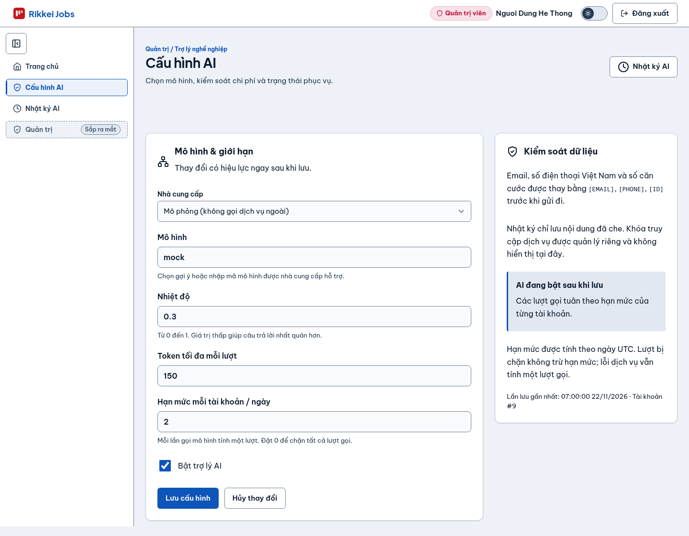
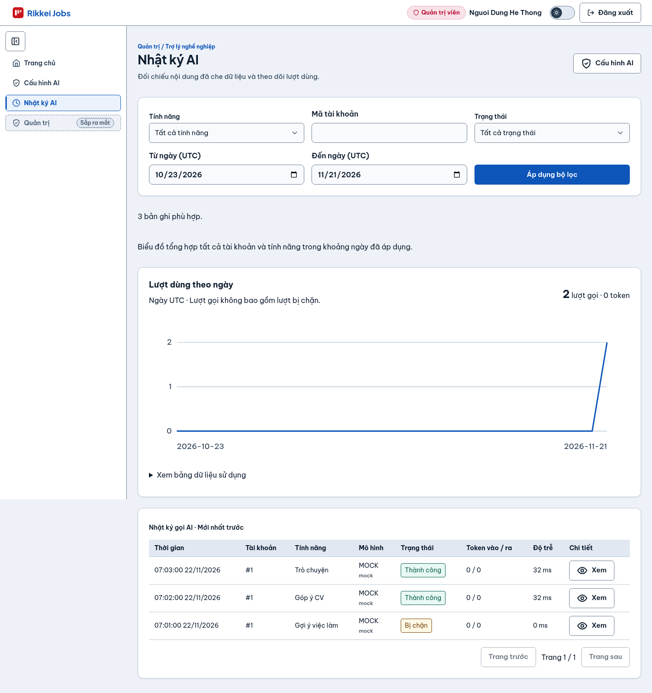
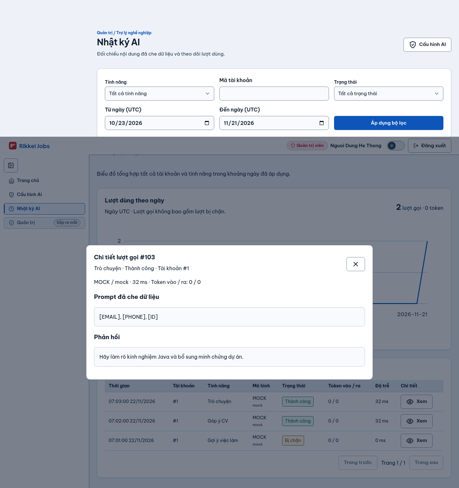

# AI-05 pull request

Title: `[AI-05] T023DF5: add AI privacy, quotas and administrator audit controls`

Target: `develop`. Source: `feature/t023df5-ai-safety-controls`.

An AI request containing an email, Vietnamese phone number or national ID is now masked before
leaving the application and before audit persistence. The shared gateway checks live DB settings,
atomically reserves daily usage and records OK, ERROR or BLOCKED in independent transactions.
Exhausted quota returns 429, while disabling AI returns `AI đang tạm tắt`, including the existing
recommendation cache path. Provider model/temperature/token limits are editable without code changes.

The ADMIN UI provides settings, filtered and paginated audit logs, a masked prompt/response dialog,
and daily usage chart with an accessible data table. The four new REST operations require ADMIN
at the route and method boundaries and appear in OpenAPI. V17 adds AI-owned tables and indexes
without changing existing migrations or adding cross-module foreign keys.

## Run and data

See [run instructions, sample requests and acceptance scenarios](README.md) and
[synthetic SQL fixture](sample-data.sql). API dates and daily quotas use UTC. Each model call
consumes one unit; a recommendation refresh can make up to five calls. Failed provider calls count,
blocked calls do not. Token totals use actual provider metadata and separately expose missing usage.

The default integration test uses PostgreSQL 18.6 Testcontainers. The explicit host-database
mode runs the same assertions without skipping; local PostgreSQL 18.4 evidence is supplemental.

## Validation

Current command output and outstanding environment blockers are recorded in [verification](VERIFICATION.md).

- Backend AI unit suite: 47 tests passed, no failures/errors/skips.
- Disposable host PostgreSQL 18.4 integration: 13 tests passed, no failures/errors/skips.
- Full frontend suite: 441 tests passed across 38 files; lint, typecheck and build passed.
- Java compilation, Spotless, SpotBugs, Markdownlint, CSpell and agent mirror/validation passed.
- `./check.sh` exited 1: **NOT VERIFIED** pinned Testcontainers and the four Docker-based
  linters because `/var/run/docker.sock` is unavailable. No tests or checks were bypassed.
The suite covers PII masking (16 examples plus null/empty), all four feature enums, live settings,
429/BLOCKED, disabled mode, concurrent quota, rollback-resistant audit, provider token metadata,
non-ADMIN 403, log filters, configuration conflicts, OpenAPI and administrator UI interactions.

AI-01 is the only existing AI feature on this checkout of develop. CV, practice and chat must use
the common feature-aware gateway when their endpoints arrive; no placeholder endpoints were added.

## Screenshots

Browser captures use synthetic HTTP fixtures and are explicitly not live-backend end-to-end proof.
They cover mobile/tablet/desktop, light/dark, no page overflow, dialog Escape and settings submission.

[Mobile](screenshots/ai-logs-375.png) · [Dark mode](screenshots/ai-logs-dark-1440.png)

## Migration regression coverage

The existing profile and migration suites now expect V17 in the latest inventory: 9 schema
migrations, or 16 migrations including dev seeds. The test specifically validating the V15
upgrade is pinned to target 15, preserving its original one-migration expectation. Seed
exclusion, zero production users, upgrade data and idempotency assertions remain intact.
An additional real-database test checks the exact latest/dev/V15 version lists and V17 table
presence without populating production users.

## Review status

- [ ] Re-run Docker-dependent gates against the pinned images.
- [ ] A team member reviews this change.
- [ ] Mentor approves before merge to develop.
