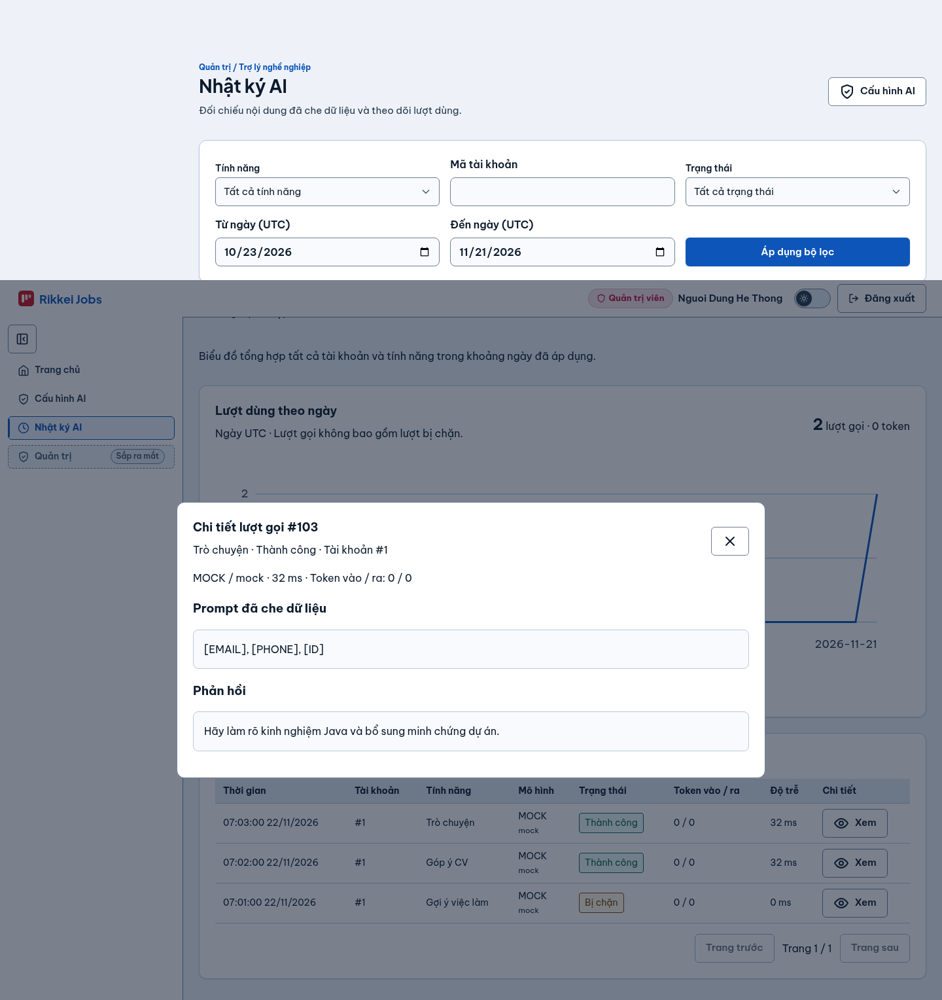

# T023DF5 — AI-05: AI safety controls

Branch: `feature/t023df5-ai-safety-controls`. PR target: `develop`.

## English

### Behavior

All existing AI provider invocations pass through `AiService`. It masks email addresses,
Vietnamese mobile/landline numbers and 12-digit national IDs before dispatch. Both prompts
and responses are masked again at the audit boundary. Provider failures use generic audit
messages and retain the existing safe fallback; quota rejection returns HTTP 429.

A conditional PostgreSQL upsert reserves one daily unit per model invocation across processes.
Reservations and audit writes have independent short transactions. A caller rollback cannot
erase either. Provider network calls run outside database transactions. Failures consume one
unit, while blocked requests and cache hits do not. The existing recommendation refresh can
make up to five model calls, so it can consume five units.

The AI-01 recommendation endpoint checks the enabled switch before serving its 24-hour cache.
When disabled it returns HTTP 200, an empty item list and `message: "AI đang tạm tắt"`.
The candidate UI displays that message. CV, PRACTICE and CHAT are supported by the common
feature enum and gateway; their feature endpoints do not exist on this checkout of develop.

Settings bootstrap from the existing provider/model properties on first use. Defaults:
temperature 0.30, max tokens 150, daily limit 100, enabled true. Keys stay in environment
configuration; no credential is accepted or returned by the settings API. Temperature is
validated in 0–1, max tokens in 1–8192, and daily limit in 0–100000. Model identifiers are
bounded and reject path separators. Submit the latest `version` when saving; a stale version
returns 409 so concurrent administrator changes are not overwritten.

### Run

Use the repository's existing development setup in [local development](../02-local-development-troubleshooting.md).
No dependencies or pinned versions changed. Flyway applies the new V17 production DDL;
existing migrations remain unchanged. The AI module owns `ai_config`, `ai_logs`, `ai_usage`.
No cross-module foreign keys or joins were added. Bootstrap is application configuration,
not development seed data.

Open `/admin/ai-config` and `/admin/ai-logs` as ADMIN. Other authenticated roles receive 403
from the backend. Both frontend routes require ADMIN as well. OpenAPI is generated from
controller annotations and available at `/api/api-docs` under the dev profile.

### API examples

All paths use the common `/api/v1` prefix and the existing in-memory Bearer token flow.
The following JSON is a synthetic settings example, using the `version` from GET:

```json
{
  "provider": "MOCK",
  "model": "mock",
  "temperature": 0.3,
  "maxTokens": 150,
  "dailyLimitPerUser": 2,
  "enabled": true,
  "version": 0
}
```

- `GET /api/v1/admin/ai-config`: current settings, audit metadata and version.
- `PUT /api/v1/admin/ai-config`: validated full update, returns the saved version.
- `GET /api/v1/admin/ai-logs?feature=CHAT&userId=1&status=BLOCKED&from=2026-11-21&to=2026-11-22&page=0&size=20`:
  filtered, newest-first logs. Page size is bounded at 100. Date range defaults to the last
  30 UTC days and is capped at 366 days. Dates are inclusive ISO days, not local timestamps.
- `GET /api/v1/admin/ai-usage/summary?from=2026-11-21&to=2026-11-22`: daily and feature
  aggregates, including OK/ERROR/BLOCKED counts and input/output token totals.

Provider-reported token counts are preserved; missing metadata remains null, and summaries
separately count calls with unknown tokens. Mock requests report zero tokens. Summary chart
dates apply to all accounts/features; log filters are separately applied to the log table and
this distinction is labeled in the UI.

### Samples and acceptance checks

[Sample SQL](sample-data.sql) inserts synthetic masked logs and sets a two-call mock quota.
Use a disposable development database only. It intentionally consumes that user's daily quota.
It is a demo fixture, not a migration and not acceptance evidence.

Automated acceptance scenarios in `AiGovernanceIntegrationTest` and `AiServiceTest`:

1. `a@b.com, 0912345678` reaches the provider and database as `[EMAIL], [PHONE]`.
2. With daily limit 2, two calls succeed and the third is rejected with 429 plus BLOCKED log.
3. Twenty concurrent quota reservations accept exactly two; a different account/day is isolated.
4. Disabled AI returns the required message across all feature enums and bypasses cached AI-01.
5. CANDIDATE, HR, MENTOR and STAFF receive 403 on every admin route; anonymous gets 401.
6. Validation, optimistic update conflicts, log filters, usage aggregation and OpenAPI paths work.
7. An outer transaction rollback cannot erase audit or consumed usage.

```bash
cd backend
./mvnw -Dtest=PiiMaskerTest,AiServiceTest,AiClientTest,JobRecommendationServiceTest test
./mvnw -Dtest=AiGovernanceIntegrationTest test
```

The second command defaults to Testcontainers `postgres:18.6-alpine` and needs Docker.
A supplemental local run can explicitly supply `-Dai05.test.jdbcUrl=jdbc:postgresql://127.0.0.1:PORT/DATABASE`
and `-Dai05.test.username=USER` for a disposable database. This does not skip any tests.
The local machine has PostgreSQL 18.4; that run is not proof against the pinned 18.6 image.
For a reproducible supplemental run, set Java 25 on PATH and run
`python3 docs/ai05/run-local-integration.py` from the repository root. The helper binds only
loopback, uses a unique temporary database directory and removes it after stopping PostgreSQL.

```bash
npm --prefix frontend test
npm --prefix frontend run lint
npm --prefix frontend run build
./check.sh
node scripts/validate-agent-config.mjs
node scripts/sync-agent-config.mjs --check
```

### Browser preview

[Browser observations](browser-observations.json) and [capture script](capture-ui.mjs) use
synthetic HTTP fixtures, not a live backend. Run the frontend dev server on port 5195, then
run `node docs/ai05/capture-ui.mjs` with Playwright available. Optional environment variables
`AI05_UI_BASE`, `AI05_PLAYWRIGHT_MODULE`, and `AI05_BROWSER_PATH` select a local server,
module or installed Chromium without storing machine-specific paths in the repository.

The captures cover 375, 768, 1024 and 1440px, light/dark mode, masked detail dialog, Escape,
configuration save payload and text contrast. The existing dev-only `mockRole` preview is used.




[Mobile audit](screenshots/ai-logs-375.png) · [Dark audit](screenshots/ai-logs-dark-1440.png)

## Tiếng Việt

T023DF5 bổ sung cấu hình AI lưu trong DB, che dữ liệu cá nhân trước khi gửi mô hình,
giới hạn theo tài khoản/ngày và nhật ký cho từng lần gọi. Hạn mức tính theo lượt gọi mô hình,
không tính lượt bị chặn; lỗi dịch vụ vẫn tính lượt. Ngày được tính theo UTC và hiển thị rõ trên UI.

ADMIN quản lý tại `/admin/ai-config`, tra cứu tại `/admin/ai-logs`. Các vai trò khác bị chặn 403.
Tắt AI trả đúng thông báo `AI đang tạm tắt`, kể cả khi có gợi ý đã lưu trong bộ nhớ đệm.

Chạy các lệnh kiểm tra ở phần trên. Bộ test mặc định dùng PostgreSQL 18.6 qua Testcontainers;
Docker chưa hoạt động trên máy hiện tại. Kết quả PostgreSQL 18.4 cục bộ là kiểm tra bổ sung.
Ảnh giao diện sử dụng dữ liệu giả lập được ghi rõ, không thay thế bằng chứng tích hợp backend.

Người dùng đã cho phép agent commit/push nhánh task và tạo PR với tiêu đề bắt đầu
`[AI-05]` vào `develop`. Không commit trực tiếp hoặc tự merge vào `develop`/`main`.
Một thành viên cần review và mentor duyệt trước khi Team Lead merge PR.
