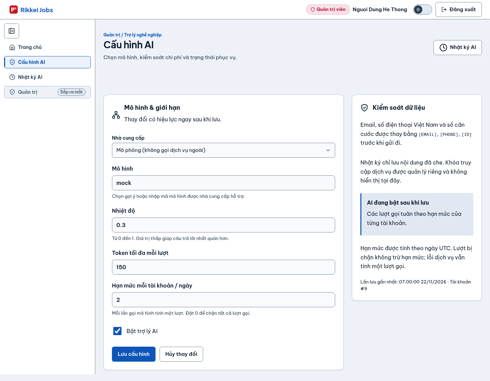
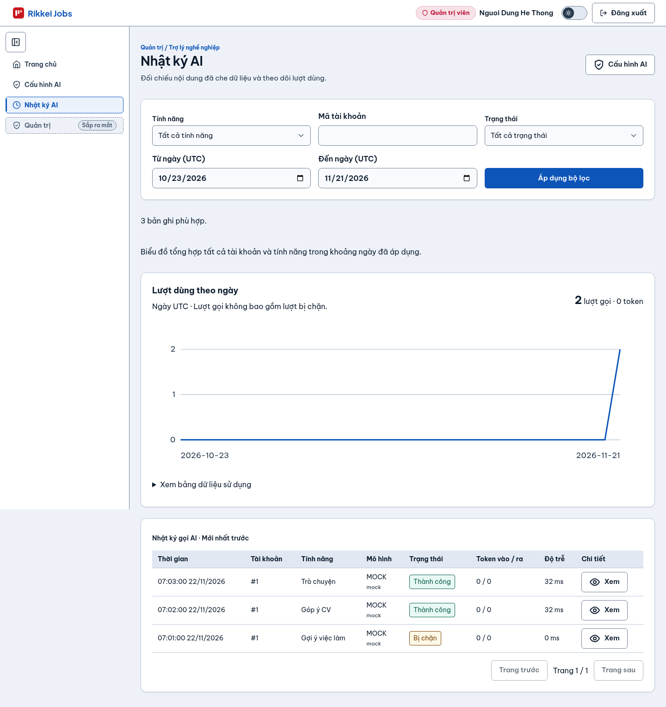

# T023DF5 — AI-05: AI safety controls

Branch: `feature/t023df5-ai-safety-controls`. PR target: `develop`.

## English

### Behavior

All existing AI provider invocations pass through `AiService`. It masks email addresses,
Vietnamese mobile/landline numbers and 12-digit national IDs before dispatch. Both prompts
and responses are masked again at the audit boundary. Provider failures use generic audit
messages and retain the existing safe fallback; quota rejection returns HTTP 429.

A conditional PostgreSQL upsert reserves one daily unit per model invocation across processes.
Reservations and audit writes have independent short transactions. A caller rollback cannot
erase either. Provider network calls run outside database transactions. Failures consume one
unit, while blocked requests and cache hits do not. The existing recommendation refresh can
make up to five model calls, so it can consume five units.

The AI-01 recommendation endpoint checks the enabled switch before serving its 24-hour cache.
When disabled it returns HTTP 200, an empty item list and `message: "AI đang tạm tắt"`.
The candidate UI displays that message. CV, PRACTICE and CHAT are supported by the common
feature enum and gateway; their feature endpoints do not exist on this checkout of develop.

Settings bootstrap from the existing provider/model properties on first use. Defaults:
temperature 0.30, max tokens 150, daily limit 100, enabled true. Keys stay in environment
configuration; no credential is accepted or returned by the settings API. Temperature is
validated in 0–1, max tokens in 1–8192, and daily limit in 0–100000. Model identifiers are
bounded and reject path separators. Submit the latest `version` when saving; a stale version
returns 409 so concurrent administrator changes are not overwritten.

### Run

Use the repository's existing development setup in [local development](../02-local-development-troubleshooting.md).
No dependencies or pinned versions changed. Flyway applies the new V17 production DDL;
existing migrations remain unchanged. The AI module owns `ai_config`, `ai_logs`, `ai_usage`.
No cross-module foreign keys or joins were added. Bootstrap is application configuration,
not development seed data.

Open `/admin/ai-config` and `/admin/ai-logs` as ADMIN. Other authenticated roles receive 403
from the backend. Both frontend routes require ADMIN as well. OpenAPI is generated from
controller annotations and available at `/api/api-docs` under the dev profile.

### API examples

All paths use the common `/api/v1` prefix and the existing in-memory Bearer token flow.
The following JSON is a synthetic settings example, using the `version` from GET:

```json
{
  "provider": "MOCK",
  "model": "mock",
  "temperature": 0.3,
  "maxTokens": 150,
  "dailyLimitPerUser": 2,
  "enabled": true,
  "version": 0
}
```

- `GET /api/v1/admin/ai-config`: current settings, audit metadata and version.
- `PUT /api/v1/admin/ai-config`: validated full update, returns the saved version.
- `GET /api/v1/admin/ai-logs?feature=CHAT&userId=1&status=BLOCKED&from=2026-11-21&to=2026-11-22&page=0&size=20`:
  filtered, newest-first logs. Page size is bounded at 100. Date range defaults to the last
  30 UTC days and is capped at 366 days. Dates are inclusive ISO days, not local timestamps.
- `GET /api/v1/admin/ai-usage/summary?from=2026-11-21&to=2026-11-22`: daily and feature
  aggregates, including OK/ERROR/BLOCKED counts and input/output token totals.

Provider-reported token counts are preserved; missing metadata remains null, and summaries
separately count calls with unknown tokens. Mock requests report zero tokens. Summary chart
dates apply to all accounts/features; log filters are separately applied to the log table and
this distinction is labeled in the UI.

### Samples and acceptance checks

[Sample SQL](sample-data.sql) inserts synthetic masked logs and sets a two-call mock quota.
Use a disposable development database only. It intentionally consumes that user's daily quota.
It is a demo fixture, not a migration and not acceptance evidence.

Automated acceptance scenarios in `AiGovernanceIntegrationTest` and `AiServiceTest`:

1. `a@b.com, 0912345678` reaches the provider and database as `[EMAIL], [PHONE]`.
2. With daily limit 2, two calls succeed and the third is rejected with 429 plus BLOCKED log.
3. Twenty concurrent quota reservations accept exactly two; a different account/day is isolated.
4. Disabled AI returns the required message across all feature enums and bypasses cached AI-01.
5. CANDIDATE, HR, MENTOR and STAFF receive 403 on every admin route; anonymous gets 401.
6. Validation, optimistic update conflicts, log filters, usage aggregation and OpenAPI paths work.
7. An outer transaction rollback cannot erase audit or consumed usage.

```bash
cd backend
./mvnw -Dtest=PiiMaskerTest,AiServiceTest,AiClientTest,JobRecommendationServiceTest test
./mvnw -Dtest=AiGovernanceIntegrationTest test
```

The second command defaults to Testcontainers `postgres:18.6-alpine` and needs Docker.
A supplemental local run can explicitly supply `-Dai05.test.jdbcUrl=jdbc:postgresql://127.0.0.1:PORT/DATABASE`
and `-Dai05.test.username=USER` for a disposable database. This does not skip any tests.
The local machine has PostgreSQL 18.4; that run is not proof against the pinned 18.6 image.
For a reproducible supplemental run, set Java 25 on PATH and run
`python3 docs/ai05/run-local-integration.py` from the repository root. The helper binds only
loopback, uses a unique temporary database directory and removes it after stopping PostgreSQL.

```bash
npm --prefix frontend test
npm --prefix frontend run lint
npm --prefix frontend run build
./check.sh
node scripts/validate-agent-config.mjs
node scripts/sync-agent-config.mjs --check
```

### Browser preview

[Browser observations](browser-observations.json) and [capture script](capture-ui.mjs) use
synthetic HTTP fixtures, not a live backend. Run the frontend dev server on port 5195, then
run `node docs/ai05/capture-ui.mjs` with Playwright available. Optional environment variables
`AI05_UI_BASE`, `AI05_PLAYWRIGHT_MODULE`, and `AI05_BROWSER_PATH` select a local server,
module or installed Chromium without storing machine-specific paths in the repository.

The captures cover 375, 768, 1024 and 1440px, light/dark mode, masked detail dialog, Escape,
configuration save payload and text contrast. The existing dev-only `mockRole` preview is used.






[Mobile audit](screenshots/ai-logs-375.png) · [Dark audit](screenshots/ai-logs-dark-1440.png)

## Tiếng Việt

T023DF5 bổ sung cấu hình AI lưu trong DB, che dữ liệu cá nhân trước khi gửi mô hình,
giới hạn theo tài khoản/ngày và nhật ký cho từng lần gọi. Hạn mức tính theo lượt gọi mô hình,
không tính lượt bị chặn; lỗi dịch vụ vẫn tính lượt. Ngày được tính theo UTC và hiển thị rõ trên UI.

ADMIN quản lý tại `/admin/ai-config`, tra cứu tại `/admin/ai-logs`. Các vai trò khác bị chặn 403.
Tắt AI trả đúng thông báo `AI đang tạm tắt`, kể cả khi có gợi ý đã lưu trong bộ nhớ đệm.

Chạy các lệnh kiểm tra ở phần trên. Bộ test mặc định dùng PostgreSQL 18.6 qua Testcontainers;
Docker chưa hoạt động trên máy hiện tại. Kết quả PostgreSQL 18.4 cục bộ là kiểm tra bổ sung.
Ảnh giao diện sử dụng dữ liệu giả lập được ghi rõ, không thay thế bằng chứng tích hợp backend.

Người dùng đã cho phép agent commit/push nhánh task và tạo PR với tiêu đề bắt đầu
`[AI-05]` vào `develop`. Không commit trực tiếp hoặc tự merge vào `develop`/`main`.
Một thành viên cần review và mentor duyệt trước khi Team Lead merge PR.

## AI05-fix

This section documents all configuration, behavioral, schema, and hygiene updates implemented in round `AI05-fix` (`T023DF5`) on branch `feature/t023df5-ai-safety-controls`. Existing sections above are preserved verbatim.

### A1 — PII Masking Hardening (`PiiMasker`)

- **Unicode and obfuscation normalization**: Strips invisible zero-width and bidirectional control characters (`\u00AD`, `\u034F`, `\u061C`, `\u200B-\u200F`, `\u202A-\u202E`, `\u2060`, `\u2066-\u2069`, `\uFEFF`) and applies `Normalizer.Form.NFKC` per non-ASCII code point to normalize full-width digits and `@` signs for detection, while tracking `origStarts`/`origEnds` UTF-16 offsets so matched spans are replaced directly inside the original text.
- **Detection coverage and precedence**: Non-overlapping replacement order is `` `[EMAIL]` `` -> `` `[ID]` `` -> `` `[PHONE]` ``. Supports obfuscated/separated 12-digit national IDs (`3-3-3-3`, `4-4-4`, `6-6`, `1x12`), Vietnamese phone numbers with `+84`, `0084`, or bare `84` country prefixes, landline numbers `(028)...`, and digit-by-digit spaced phones (`0 9 1 2 3 4 5 6 7 8`). Masking is strictly idempotent (`mask(mask(x)) == mask(x)`).
- **Bounded-time guarantee**: Replaces regex email scanning with an `O(N)` linear scan anchored on `indexOf('@')` and uses fixed-length / bounded quantifiers for IDs and phones. Hostile 1 MB inputs complete well under the `1000 ms` guarantee (`52–127 ms` measured in `PiiMaskerTest`).
- **False-positive policy and fail-closed gateway**: Preserves 4-digit years, ISO dates (`2026-11-23`), salary figures (`15.000.000`), semantic versions (`4.1.2`), 9-digit numbers, 11-digit non-Vietnamese numbers, and numbers with `>= 13` digits. Continuous 12-digit numeric strings (such as `842838221234`) map to `` `[ID]` ``, whereas separator-grouped `84-28-3822-1234` maps to `` `[PHONE]` ``. Any masker exception fails closed in `AiService`: neither `audit.reserve`, `client.generate`, nor `audit.record` runs with unmasked text.

### A2 — Graceful Quota Degradation for Job Recommendations

- **Contract separation**: `AiService.generate(...)` continues to throw `RateLimitException` (HTTP 429) and write a `BLOCKED` `ai_logs` row for direct gateway callers. In `JobRecommendationService.computeRecommendations(...)`, per-slot `RateLimitException` is caught inside the explanation loop: remaining slots in that refresh stop calling `AiService` (at most **1** `BLOCKED` row per refresh), deterministic skill-match fallback (`isAiGenerated: false`) is used, and the endpoint returns HTTP `200` with `meta.message` set to `"Đã đạt hạn mức giải thích AI trong ngày. Đang hiển thị gợi ý phù hợp theo kỹ năng."`.
- **Cache recovery policy (`quota_degraded`)**: `V17__ai_governance.sql` adds `job_recommendations.quota_degraded BOOLEAN NOT NULL DEFAULT FALSE`. Degraded snapshots are flagged `quota_degraded = true` so subsequent views while still over quota reuse the fallback cache with zero extra `BLOCKED` rows, while `isCacheUsable(...)` checks `aiService.hasQuotaAvailable(userId)` and forces recomputation once daily UTC quota resets or an admin raises `dailyLimitPerUser`.
- **Frontend display**: `JobRecommendationsSection.tsx` renders `.recommendations-notice` (`role="status"`) above `.jobs-grid` whenever `recommendations.length > 0` and `meta.message` is present.

### A3 — Zero-Log Disabled Mode for Recommendations

- Removed the synthetic `aiService.generate(userId, AiFeature.RECOMMEND, "", "")` call from the disabled branch of `JobRecommendationService.getRecommendations(...)`.
- When `enabled=false`, `GET /api/v1/me/job-recommendations` returns HTTP `200` with an empty item list and `message: "AI đang tạm tắt"`, never leaks cached explanations, and produces **0** writes to `ai_logs` or `ai_usage`. Direct `AiService.generate(...)` invocations while disabled continue to record one `BLOCKED` row at the gateway boundary.

### A4 — Frontend Formatting Noise Cleanup

- Reverted 7 unrelated Prettier line-wrapping hunks in `frontend/src/App.tsx` and 2 unrelated hunks in `frontend/src/features/identity/pages/role-homes/AdminHomePage.tsx` back to `origin/develop`, leaving only the AI route lazy imports, route preloader registrations, `<Route>` declarations, and admin home navigation card.

### A5 — In-Memory Config Snapshot Cache & Concurrency-Safe Init

- **New property**: `app.ai.config-cache-ttl-ms` (default `5000`, bound via `AiGovernanceProperties` in `application.yml`).
- **Thread-safe TTL snapshot**: `AiConfigService.get()` reads an immutable `volatile CachedConfig` snapshot checked against the injected `java.time.Clock`, avoiding DB queries and `REQUIRES_NEW` transactions on cache hits. Cache misses synchronize on `refreshLock` with double-checked locking, `TransactionTemplate(PROPAGATION_REQUIRES_NEW)`, and an `invalidationGeneration` counter to prevent stale overwrites.
- **Invalidation & multi-instance staleness bound**: `AiConfigService.update(...)` invalidates the local snapshot immediately (and via `TransactionSynchronization.afterCompletion` when active). Across multiple backend instances, configuration staleness is strictly bounded by `<= TTL` (`<= 5000 ms` by default). Singleton row bootstrap retains idempotent `ON CONFLICT (id) DO NOTHING`.

### A6 — Provider Key & Model Identifier Validation

- **Blank API key rejection**: `PUT /api/v1/admin/ai-config` rejects `OPENAI`, `GEMINI`, and `CLAUDE` when the corresponding `ai.<provider>.api-key` is null or blank with HTTP `400` (`VALIDATION_ERROR`) and the generic message `"Chưa cấu hình khóa API cho nhà cung cấp này"` (never exposing key values or environment internals). `MOCK` is always permitted.
- **Per-provider model path-safety validation**: `UpdateAiConfigRequest` and `AiConfigService.validateModel(...)` reject `/`, `\`, `..`, `?`, `#`, whitespace, and ISO control characters (`<= 120` chars, starting alphanumeric), and disallow `:` on `GEMINI` and `MOCK` while permitting `:` on `OPENAI` and `CLAUDE`. `frontend/src/features/ai/admin/AiConfigPage.tsx` mirrors this validation client-side, preserves form inputs on `400`/`409` alerts, and clears alerts when clicking `"Hủy thay đổi"`.

### A7 — Daily Log Retention Job, V17 Index Tuning & Bounded Pagination Count

- **Retention properties & defaults** (`application.yml` / `AiGovernanceProperties`):
  - `app.ai.log-retention-days` (default `90`, env `AI_LOG_RETENTION_DAYS`)
  - `app.ai.log-retention-batch-size` (default `5000`, env `AI_LOG_RETENTION_BATCH_SIZE`)
  - `app.ai.log-retention-time-budget-ms` (default `10000`, env `AI_LOG_RETENTION_TIME_BUDGET_MS`)
  - `app.ai.log-retention-cron` (default `0 15 2 * * *` UTC, env `AI_LOG_RETENTION_CRON`)
  - `app.ai.log-retention-max-batches` (default `1000`, env `AI_LOG_RETENTION_MAX_BATCHES`)
- **Multi-instance safe execution**: `AiSchedulingConfig` (`@EnableScheduling`) defines bounded `aiRetentionExecutor` (`core=1`, `max=1`, `queue=1`, `ai-retention-` prefix, `DiscardPolicy`). `AiLogRetentionJob` uses injected `Clock`, acquires PostgreSQL session advisory lock `pg_try_advisory_lock(827364519201)` on a dedicated JDBC connection (always unlocked in `finally`), and deletes oldest batches via `ORDER BY created_at ASC, id ASC LIMIT :batchSize` within the configured time and batch budgets.
- **`V17__ai_governance.sql` Candidate 1B index set**:
  - `idx_ai_logs_created_at_id` on `ai_logs (created_at DESC, id DESC) INCLUDE (feature, status, tokens_in, tokens_out)`
  - `idx_ai_logs_user_id_created_at_id` on `ai_logs (user_id, created_at DESC, id DESC)`
  - `idx_ai_logs_non_ok_status` partial index on `ai_logs (status, created_at DESC, id DESC) WHERE status <> 'OK'`
  - Removed unused `idx_ai_logs_feature_created_at`, `idx_ai_logs_status_created_at`, and `idx_ai_usage_date`.
- **Bounded pagination count**: `AiLogRepository.search(...)` caps `COUNT(*)` at `COUNT_CAP = 10_000` (`LIMIT 10001`), returning `totalCapped: true` in `AiLogPage` when exceeded; `AiLogsPage.tsx` renders `10.000+` (`totalCapped`).

### A8 — Documentation Hygiene, Sample Data & E2E Coverage

- **Removed binaries and ad-hoc scripts** from `docs/ai05/`:
  - `docs/ai05/capture-ui.mjs`
  - `docs/ai05/run-local-integration.py`
  - 11 PNG files under `docs/ai05/screenshots/` (and the empty directory):
    1. `ai-config-1024.png`
    2. `ai-config-1440.png`
    3. `ai-config-375.png`
    4. `ai-config-768.png`
    5. `ai-config-dark-1440.png`
    6. `ai-log-detail-1440.png`
    7. `ai-logs-1024.png`
    8. `ai-logs-1440.png`
    9. `ai-logs-375.png`
    10. `ai-logs-768.png`
    11. `ai-logs-dark-1440.png`
- **Gitignore & screenshots**: Added `docs/ai05/pr-screenshots/` to `.gitignore` for local PR screenshots (never committed).
- **Synthetic fixture check**: Verified `docs/ai05/sample-data.sql` contains strictly synthetic values (`MOCK`, `` `[EMAIL], [PHONE]` ``, `` `Profile [ID]` ``, `user_id = 1`) and loads cleanly onto `postgres:18.6-alpine` after `V1`, `V2`, `V11`, `V17`.
- **E2E suite**: Added `e2e/tier2-boundaries/test_ai_governance_admin.test.mjs` (registered in `e2e/run-all.mjs`) covering 401/403 RBAC on all 4 `/api/v1/admin/ai-*` endpoints, 400 param validation, 409 stale-version conflict, A6 blank-key & model validation, A3 disabled zero-log views, A2 quota fallback, and UTC summary/logs count agreement.
