# Entity Relationship Diagram (ERD) / Sơ Đồ Thực Thể Liên Kết (ERD)

---

## Part 1: English Section

### 1. Architecture and Data Isolation Principles

The **Rikkei Jobs** backend follows a **Modular Monolith** architecture under `backend/src/main/java/com/rikkei/jobs/` running on **PostgreSQL 18.6** (`postgres:18.6-alpine`) and **Flyway 12.4.0** (`validate-on-migrate: true`, `spring.jpa.hibernate.ddl-auto: none`, `spring.jpa.open-in-view: false`).

Core database boundary rules:

1. **Strict Single-Module Table Ownership**: Every table is owned by exactly one module. Other modules never write to it or execute cross-module SQL `JOIN` queries against it.
2. **Zero Cross-Module Physical Foreign Keys**: Physical `FOREIGN KEY` constraints are allowed **only** between tables owned by the same module. All cross-module references are stored as plain scalar IDs (`BIGINT`, `INT`, or `VARCHAR` business code such as `skills.code`).
3. **Immutable Odd/Even Flyway Versioning (`V1`–`V25`)**:
   - Production DDL scripts live in `backend/src/main/resources/db/migration/` using strictly **odd** version numbers (`V1`, `V3`, `V5`, `V7`, `V9`, `V11`, `V13`, `V15`, `V17`, `V19`, `V21`, `V23`, `V25`; next available `V27`).
   - Development seed DML scripts live in `backend/src/main/resources/db/migration-dev/` using strictly **even** version numbers (`V2`, `V4`, `V6`, `V8`, `V10`, `V12`, `V14`, `V22`, `V24`; next available `V26`).
   - Version numbers are globally unique across both folders. Production (`prod` profile) loads only odd migrations (`13` files); development (`dev` profile) loads both odd and even migrations (`22` files combined).

---

### 2. Module Ownership Across All 9 Packages

The backend contains **9 packages** under `com.rikkei.jobs`: **7 active database-owning modules** (`33` production tables across `V1..V25`), **1 planned business module** (`learning`, `package-info.java` only, `0` production tables yet), and **1 infrastructure module** (`common`, `0` tables).

| # | Package (`com.rikkei.jobs.<pkg>`) | Status | Production Tables (`V1..V25`) | Table List |
|---|---|---|---|---|
| 1 | `identity` | Active DB owner | 4 (`V1, V5`) | `roles`, `users`, `used_sso_tickets`, `password_reset_tokens` |
| 2 | `assessment` | Active DB owner | 5 (`V1, V3, V7`) | `skills`, `evaluation_templates`, `evaluation_criteria`, `evaluations`, `evaluation_scores` |
| 3 | `candidate` | Active DB owner | 11 (`V3, V13, V25`) | `candidate_profiles`, `external_records`, `skill_mappings`, `skill_evidences`, `skill_scores`, `target_positions`, `position_skills`, `candidate_targets`, `gap_results`, `manual_overrides`, `sync_runs` |
| 4 | `company` | Active DB owner | 3 (`V9, V11`) | `companies`, `jobs`, `job_skills` |
| 5 | `ai` | Active DB owner | 4 (`V11, V17`) | `job_recommendations`, `ai_config`, `ai_logs`, `ai_usage` |
| 6 | `internship` | Active DB owner | 2 (`V15`) | `internships`, `internship_tasks` (planned future tables: `internship_batches`, `internship_members`) |
| 7 | `learning` | Planned (`package-info.java` only) | 0 | None created yet (planned: `skill_gaps`, `learning_recommendations`, `course_enrollments`) |
| 8 | `recruitment` | Active DB owner | 4 (`V19, V21, V23`) | `applications`, `application_status_history`, `application_cv_snapshots`, `interview_rounds` (planned future UT-07 tables: `interview_rooms`, `job_offers`) |
| 9 | `common` | Shared infrastructure | 0 | Cross-cutting security, exceptions, external client, and validation only |

**Total production tables**: `33` (`4` `identity` + `5` `assessment` + `11` `candidate` + `3` `company` + `4` `ai` + `2` `internship` + `4` `recruitment`) across `13` odd prod migrations (`V1..V25`) and `9` even dev seeds (`V2..V24`, `22` combined in `dev`).

---

### 3. Entity Relationship Diagram (All 33 Production Tables)

Diagram conventions:

- **Solid lines (`--`)**: Physical `FOREIGN KEY` constraints (`13` total, 100% intra-module across `identity`, `assessment`, `candidate`, `internship`, and `recruitment`).
- **Dashed lines (`..`)**: Logical scalar references without a physical `FOREIGN KEY` constraint (`5` intra-module non-FK scalar references plus all cross-module scalar references, including `users.company_id` <-> `companies.id`).
- **Mermaid type tokens**: Parameterized SQL types are written as Mermaid-safe tokens without parentheses or spaces (for example, `varchar_255` for `VARCHAR(255)` and `numeric_5_2` for `NUMERIC(5, 2)`). Exact SQL definitions appear in Section 5.

```mermaid
erDiagram
    %% Module: identity (4 tables)
    roles {
        serial id PK
        varchar_50 name UK
        varchar_255 description
    }

    users {
        bigserial id PK
        varchar_100 email UK
        varchar_255 password_hash "nullable for LMS SSO"
        varchar_100 full_name
        varchar_50 lms_user_id UK
        int role_id FK "physical FK to roles"
        bigint company_id "scalar to companies.id"
        boolean must_change_password
        int failed_login_count
        timestamptz locked_until
        varchar_20 status "ACTIVE or LOCKED"
        timestamptz created_at
        timestamptz updated_at
    }

    used_sso_tickets {
        varchar_255 ticket PK
        timestamptz used_at
    }

    password_reset_tokens {
        bigserial id PK
        bigint user_id FK "physical FK cascade"
        varchar_64 token_hash
        timestamptz expires_at
        timestamptz used_at
        timestamptz created_at
    }

    %% Module: assessment (5 tables)
    skills {
        serial id PK
        varchar_50 code UK
        varchar_100 name_vi
        varchar_100 name_en
        jsonb level_bands
        varchar_50 scale
        text description
        varchar_50 skill_group
    }

    evaluation_templates {
        bigserial id PK
        varchar_150 name UK
        varchar_100 position
        varchar_20 context UK "INTERNSHIP or INTERVIEW"
        boolean active
        timestamptz created_at
        timestamptz updated_at
    }

    evaluation_criteria {
        bigserial id PK
        bigint template_id FK "physical FK cascade"
        int skill_id FK "physical FK to skills"
        varchar_500 description
        numeric_5_2 weight
        timestamptz created_at
        timestamptz updated_at
    }

    evaluations {
        bigserial id PK
        bigint template_id FK "physical FK to templates"
        bigint user_id "scalar to users.id"
        bigint mentor_id "scalar to users.id"
        varchar_20 context "INTERNSHIP or INTERVIEW"
        bigint batch_id "planned internship scalar"
        bigint interview_round_id "planned recruitment scalar"
        varchar_20 status "DRAFT or SUBMITTED"
        text overall_comment
        timestamptz submitted_at
        bigint version
        timestamptz created_at
        timestamptz updated_at
    }

    evaluation_scores {
        bigserial id PK
        bigint evaluation_id FK "physical FK cascade"
        bigint criterion_id FK "physical FK to criteria"
        int score
        text comment
        timestamptz created_at
        timestamptz updated_at
    }

    %% Module: candidate (11 tables across V3, V13, V25)
    candidate_profiles {
        bigint user_id PK "scalar to users.id"
        boolean is_public
        timestamptz created_at
        timestamptz updated_at
    }

    external_records {
        bigserial id PK
        bigint user_id "scalar to users.id"
        varchar_10 source "LMS EXAM or PM"
        varchar_100 source_code
        varchar_160 source_key UK "V25 unique with source"
        varchar_255 title
        numeric_5_2 score
        jsonb payload "V25 source object"
        timestamptz recorded_at
        timestamptz synced_at "V25"
        timestamptz created_at
    }

    skill_mappings {
        bigserial id PK
        varchar_10 source "LMS EXAM or PM"
        varchar_100 source_code
        int skill_id "scalar to skills.id"
        numeric_4_3 weight
    }

    skill_evidences {
        bigserial id PK
        bigint user_id "scalar to users.id"
        int skill_id "scalar to skills.id"
        varchar_20 source
        varchar_100 source_ref
        varchar_255 title
        numeric_5_2 score
        numeric_4_3 weight
        timestamptz recorded_at
        boolean verified
        bigint external_record_id FK "V25 optional FK on delete set null"
        timestamptz created_at
    }

    manual_overrides {
        bigserial id PK
        bigint record_id FK "V25 physical FK to external_records"
        varchar_50 field
        text value
        varchar_500 reason
        bigint staff_id "scalar to users.id"
        timestamptz created_at
    }

    sync_runs {
        bigserial id PK
        varchar_20 trigger "NIGHTLY ON_OPEN or MANUAL"
        bigint user_id "nullable scalar to users.id"
        varchar_20 status "SUCCESS or FAILED"
        timestamptz started_at
        timestamptz finished_at
        varchar_500 error
        jsonb counts
    }

    skill_scores {
        bigint user_id PK "scalar to users.id"
        int skill_id PK "scalar to skills.id"
        numeric_5_2 verified_score
        numeric_5_2 self_score
        varchar_20 level
        timestamptz updated_at
    }

    target_positions {
        bigserial id PK
        varchar_50 code UK
        varchar_150 name
        text description
        timestamptz created_at
        timestamptz updated_at
    }

    position_skills {
        bigserial id PK
        bigint position_id "intra-module scalar"
        int skill_id "scalar to skills.id"
        int min_score
    }

    candidate_targets {
        bigint user_id PK "scalar to users.id"
        bigint position_id "intra-module scalar"
        bigint job_id "scalar to jobs.id"
        timestamptz chosen_at
    }

    gap_results {
        bigint user_id PK "scalar to users.id"
        varchar_10 target_type PK "POSITION or JOB"
        bigint target_id PK "polymorphic target scalar"
        int skill_id PK "scalar to skills.id"
        numeric_5_2 required
        numeric_5_2 current
        numeric_5_2 gap
        timestamptz computed_at
    }

    %% Module: company (3 tables)
    companies {
        bigint id PK "identity generated always"
        varchar_255 name
        varchar_13 tax_code UK
        varchar_100 industry
        varchar_20 size
        varchar_500 address
        varchar_100 city
        varchar_500 website
        varchar_500 logo_url
        varchar_255 logo_public_id
        text description
        varchar_20 status "ACTIVE or LOCKED"
        bigint created_by "scalar to users.id"
        timestamptz created_at
        timestamptz updated_at
        bigint version
    }

    jobs {
        bigserial id PK
        varchar_255 title
        bigint company_id "intra-module scalar"
        varchar_255 company_name
        varchar_255 location
        varchar_100 salary_range
        varchar_50 status
        timestamptz deadline
        text description
        timestamptz created_at
        timestamptz updated_at
    }

    job_skills {
        bigserial id PK
        bigint job_id "intra-module scalar"
        varchar_50 skill_code "scalar to skills.code"
        int required_level
        boolean mandatory
    }

    %% Module: ai (4 tables across V11, V17)
    job_recommendations {
        bigserial id PK
        bigint user_id "scalar to users.id"
        bigint job_id "scalar to jobs.id"
        int score
        text explanation
        boolean ai_generated
        boolean quota_degraded "V17"
        timestamptz created_at
    }

    ai_config {
        bigserial id PK "check id = 1"
        varchar_16 provider
        varchar_120 model
        numeric_3_2 temperature
        int max_tokens
        int daily_limit_per_user
        boolean enabled
        bigint updated_by "scalar to users.id"
        timestamptz updated_at
        bigint version
    }

    ai_logs {
        bigserial id PK
        bigint user_id "scalar to users.id"
        varchar_16 feature
        varchar_16 provider
        varchar_120 model
        text prompt_masked
        text response
        int tokens_in
        int tokens_out
        bigint latency_ms
        varchar_16 status
        timestamptz created_at
    }

    ai_usage {
        bigint user_id PK "scalar to users.id"
        date date PK
        int count
    }

    %% Module: internship (2 tables in V15)
    internships {
        bigserial id PK
        bigint user_id "scalar to users.id"
        varchar_255 batch_id
        varchar_255 batch_name
        varchar_255 group_name
        varchar_255 topic_name
        varchar_255 mentor_email
        date start_date
        date end_date
        numeric_5_2 final_score
        timestamptz synced_at
    }

    internship_tasks {
        bigserial id PK
        bigint internship_id FK "V15 physical FK cascade"
        varchar_255 title
        numeric_5_2 accepted_score
        timestamptz accepted_at
    }

    %% Module: recruitment (4 tables across V19, V21, V23)
    applications {
        bigserial id PK
        bigint job_id "scalar to jobs.id"
        bigint user_id "scalar to users.id"
        bigint cv_id "planned candidate CV scalar"
        varchar_500 cv_snapshot_url
        text cover_letter
        varchar_30 status
        bigint version
        timestamptz created_at
        timestamptz updated_at
    }

    application_status_history {
        bigserial id PK
        bigint application_id FK "V19 physical FK cascade"
        varchar_30 from_status
        varchar_30 to_status
        bigint actor_id "scalar to users.id"
        text note
        timestamptz created_at
    }

    application_cv_snapshots {
        bigint application_id PK,FK "V21 physical FK cascade"
        varchar_255 original_filename
        varchar_100 content_type
        bytea file_data
        bigint file_size
        char_64 sha256
        timestamptz created_at
    }

    interview_rounds {
        bigserial id PK
        bigint application_id FK "V23 physical FK cascade"
        int round_no
        varchar_100 name
        varchar_150 interviewer_email
        timestamptz scheduled_at
        varchar_20 result
        numeric_5_2 score
        text note
        bigint version
        timestamptz created_at
        timestamptz updated_at
    }

    %% 13 Physical Intra-Module Foreign Keys (solid lines)
    roles ||--o{ users : "physical FK role_id"
    users ||--o{ password_reset_tokens : "physical FK user_id cascade"
    evaluation_templates ||--o{ evaluation_criteria : "physical FK template_id cascade"
    skills ||--o{ evaluation_criteria : "physical FK skill_id"
    evaluation_templates ||--o{ evaluations : "physical FK template_id"
    evaluations ||--o{ evaluation_scores : "physical FK evaluation_id cascade"
    evaluation_criteria ||--o{ evaluation_scores : "physical FK criterion_id"
    external_records |o--o{ skill_evidences : "V25 physical FK external_record_id set null"
    external_records ||--o{ manual_overrides : "V25 physical FK record_id"
    internships ||--o{ internship_tasks : "V15 physical FK internship_id cascade"
    applications ||--o{ application_status_history : "V19 physical FK application_id cascade"
    applications ||--o| application_cv_snapshots : "V21 physical FK application_id cascade"
    applications ||--o{ interview_rounds : "V23 physical FK application_id cascade"

    %% 5 Intra-Module Scalar References Without Physical FK (dashed lines)
    target_positions ||..o{ position_skills : "scalar position_id"
    target_positions |o..o{ candidate_targets : "scalar position_id"
    target_positions ||..o{ gap_results : "scalar target_id POSITION"
    companies |o..o{ jobs : "scalar company_id"
    jobs ||..o{ job_skills : "scalar job_id"

    %% Cross-Module Scalar References (dashed lines, 0 physical FKs)
    companies |o..o{ users : "scalar company_id"
    users |o..o{ companies : "scalar created_by"
    users ||..o{ evaluations : "scalar user_id"
    users ||..o{ evaluations : "scalar mentor_id"
    interview_rounds |o..o{ evaluations : "scalar interview_round_id"
    users ||..o| candidate_profiles : "scalar user_id"
    users ||..o{ external_records : "scalar user_id"
    users ||..o{ manual_overrides : "scalar staff_id"
    users |o..o{ sync_runs : "scalar user_id"
    skills ||..o{ skill_mappings : "scalar skill_id"
    users ||..o{ skill_evidences : "scalar user_id"
    skills ||..o{ skill_evidences : "scalar skill_id"
    users ||..o{ skill_scores : "scalar user_id"
    skills ||..o{ skill_scores : "scalar skill_id"
    skills ||..o{ position_skills : "scalar skill_id"
    users ||..o| candidate_targets : "scalar user_id"
    jobs |o..o{ candidate_targets : "scalar job_id"
    users ||..o{ gap_results : "scalar user_id"
    jobs ||..o{ gap_results : "scalar target_id JOB"
    skills ||..o{ gap_results : "scalar skill_id"
    skills ||..o{ job_skills : "scalar skill_code"
    users ||..o{ job_recommendations : "scalar user_id"
    jobs ||..o{ job_recommendations : "scalar job_id"
    users |o..o{ ai_config : "scalar updated_by"
    users ||..o{ ai_logs : "scalar user_id"
    users ||..o{ ai_usage : "scalar user_id"
    users ||..o{ internships : "scalar user_id"
    jobs ||..o{ applications : "scalar job_id"
    users ||..o{ applications : "scalar user_id"
    users ||..o{ application_status_history : "scalar actor_id"
```

---

### 4. Cross-Module `users.company_id` Relation and Relationship Summary

#### 4.1 The `users.company_id` <-> `companies.id` Contract

- **`users.company_id`** (`identity` module, added in `V5__auth_identity_evolution.sql`): `BIGINT` nullable column with B-Tree index `idx_users_company_id`. Non-HR users keep `company_id = NULL`; HR users store the scalar `BIGINT` identifier of their assigned company.
- **`companies.id`** (`company` module, created in `V9__company_profile.sql`): `BIGINT GENERATED ALWAYS AS IDENTITY PRIMARY KEY`.
- **`companies.created_by`** (`company` module, `V9`): `BIGINT` nullable scalar referencing the `STAFF`/`ADMIN` account in `users.id` that registered the company (`idx_companies_created_by`).
- **Architectural Rule**: Neither `users.company_id` nor `companies.created_by` declares a physical `FOREIGN KEY` constraint (`CompanyMigrationIntegrationTest` explicitly asserts `companyFks.isEmpty()`). Cross-module queries and ownership checks read the authenticated principal's scalar `companyId` (`Long`) rather than joining `users` and `companies` at the SQL level.

#### 4.2 All 13 Physical Foreign Keys (100% Intra-Module)

| # | Child Table & Column | Referenced Table & Column | Owning Module | `ON DELETE` Rule | Migration |
|---|---|---|---|---|---|
| 1 | `users.role_id` | `roles(id)` | `identity` | `NO ACTION` | `V1` |
| 2 | `password_reset_tokens.user_id` | `users(id)` | `identity` | `CASCADE` | `V5` |
| 3 | `evaluation_criteria.template_id` | `evaluation_templates(id)` | `assessment` | `CASCADE` | `V7` |
| 4 | `evaluation_criteria.skill_id` | `skills(id)` | `assessment` | `NO ACTION` | `V7` |
| 5 | `evaluations.template_id` | `evaluation_templates(id)` | `assessment` | `NO ACTION` | `V7` |
| 6 | `evaluation_scores.evaluation_id` | `evaluations(id)` | `assessment` | `CASCADE` | `V7` |
| 7 | `evaluation_scores.criterion_id` | `evaluation_criteria(id)` | `assessment` | `NO ACTION` | `V7` |
| 8 | `internship_tasks.internship_id` | `internships(id)` | `internship` | `CASCADE` | `V15` |
| 9 | `application_status_history.application_id` | `applications(id)` | `recruitment` | `CASCADE` | `V19` |
| 10 | `application_cv_snapshots.application_id` | `applications(id)` | `recruitment` | `CASCADE` | `V21` |
| 11 | `interview_rounds.application_id` | `applications(id)` | `recruitment` | `CASCADE` | `V23` |
| 12 | `skill_evidences.external_record_id` | `external_records(id)` | `candidate` | `SET NULL` | `V25` |
| 13 | `manual_overrides.record_id` | `external_records(id)` | `candidate` | `NO ACTION` | `V25` |

#### 4.3 Intra-Module Scalar References Without Physical FKs (5 Cases)

| Source Table & Column | Logical Target | Owning Module | Migration & Design Note |
|---|---|---|---|
| `position_skills.position_id` | `target_positions.id` | `candidate` | `V13`, indexed (`idx_position_skills_position_id`), no `REFERENCES` |
| `candidate_targets.position_id` | `target_positions.id` | `candidate` | `V13`, nullable mutually exclusive with `job_id`, no `REFERENCES` |
| `gap_results.target_id` | `target_positions.id` (when `target_type = 'POSITION'`) | `candidate` | `V13`, polymorphic key, cannot use physical FK |
| `jobs.company_id` | `companies.id` | `company` | `V11`, nullable scalar; `V12` seeds `company_id` `1..5` while `V10` seeds companies `1..2` |
| `job_skills.job_id` | `jobs.id` | `company` | `V11`, indexed (`idx_job_skills_job_id`), no `REFERENCES` |

#### 4.4 Cross-Module Scalar References (0 Physical FKs)

| Source (`module`) | Logical Target (`module`) | Column Type | Migration |
|---|---|---|---|
| `users.company_id` (`identity`) | `companies.id` (`company`) | `BIGINT` (nullable, indexed) | `V5` |
| `companies.created_by` (`company`) | `users.id` (`identity`) | `BIGINT` (nullable, indexed) | `V9` |
| `evaluations.user_id` (`assessment`) | `users.id` (`identity`) / `candidate_profiles.user_id` (`candidate`) | `BIGINT NOT NULL` (indexed) | `V7` |
| `evaluations.mentor_id` (`assessment`) | `users.id` (`identity`) | `BIGINT NOT NULL` (indexed) | `V7` |
| `evaluations.batch_id` (`assessment`) | `internship_batches.id` (`internship`, planned) | `BIGINT` (nullable) | `V7` |
| `evaluations.interview_round_id` (`assessment`) | `interview_rounds.id` (`recruitment`) | `BIGINT` (nullable) | `V7` |
| `candidate_profiles.user_id` (`candidate`) | `users.id` (`identity`) | `BIGINT PRIMARY KEY` | `V3` |
| `external_records.user_id` (`candidate`) | `users.id` (`identity`) | `BIGINT NOT NULL` (indexed) | `V3` |
| `manual_overrides.staff_id` (`candidate`) | `users.id` (`identity`) | `BIGINT NOT NULL` (indexed) | `V25` |
| `sync_runs.user_id` (`candidate`) | `users.id` (`identity`) | `BIGINT` (nullable, indexed) | `V25` |
| `skill_mappings.skill_id` (`candidate`) | `skills.id` (`assessment`) | `INT NOT NULL` | `V3` |
| `skill_evidences.user_id` (`candidate`) | `users.id` (`identity`) | `BIGINT NOT NULL` (indexed) | `V3` |
| `skill_evidences.skill_id` (`candidate`) | `skills.id` (`assessment`) | `INT NOT NULL` (indexed) | `V3` |
| `skill_scores.user_id` (`candidate`) | `users.id` (`identity`) | `BIGINT NOT NULL` (composite PK) | `V3` |
| `skill_scores.skill_id` (`candidate`) | `skills.id` (`assessment`) | `INT NOT NULL` (composite PK) | `V3` |
| `position_skills.skill_id` (`candidate`) | `skills.id` (`assessment`) | `INT NOT NULL` | `V13` |
| `candidate_targets.user_id` (`candidate`) | `users.id` (`identity`) | `BIGINT PRIMARY KEY` | `V13` |
| `candidate_targets.job_id` (`candidate`) | `jobs.id` (`company`) | `BIGINT` (nullable) | `V13` |
| `gap_results.user_id` (`candidate`) | `users.id` (`identity`) | `BIGINT NOT NULL` (composite PK) | `V13` |
| `gap_results.target_id` (`candidate`, when `JOB`) | `jobs.id` (`company`) | `BIGINT NOT NULL` (composite PK) | `V13` |
| `gap_results.skill_id` (`candidate`) | `skills.id` (`assessment`) | `INT NOT NULL` (composite PK) | `V13` |
| `job_skills.skill_code` (`company`) | `skills.code` (`assessment`) | `VARCHAR(50) NOT NULL` (indexed) | `V11` |
| `job_recommendations.user_id` (`ai`) | `users.id` (`identity`) | `BIGINT NOT NULL` (indexed) | `V11` |
| `job_recommendations.job_id` (`ai`) | `jobs.id` (`company`) | `BIGINT NOT NULL` | `V11` |
| `ai_config.updated_by` (`ai`) | `users.id` (`identity`) | `BIGINT` (nullable) | `V17` |
| `ai_logs.user_id` (`ai`) | `users.id` (`identity`) | `BIGINT NOT NULL` (indexed) | `V17` |
| `ai_usage.user_id` (`ai`) | `users.id` (`identity`) | `BIGINT NOT NULL` (composite PK) | `V17` |
| `internships.user_id` (`internship`) | `users.id` (`identity`) | `BIGINT NOT NULL` (indexed) | `V15` |
| `applications.job_id` (`recruitment`) | `jobs.id` (`company`) | `BIGINT NOT NULL` (indexed) | `V19` |
| `applications.user_id` (`recruitment`) | `users.id` (`identity`) | `BIGINT NOT NULL` (indexed) | `V19` |
| `applications.cv_id` (`recruitment`) | Candidate CV ID (`candidate`, planned HS-04) | `BIGINT NOT NULL` | `V19` |
| `application_status_history.actor_id` (`recruitment`) | `users.id` (`identity`) | `BIGINT NOT NULL` | `V19` |

---

### 5. Exact Schema Reference for All 33 Production Tables

#### 5.1 Module `identity` (4 Tables)

| Table (`Migrations`) | Key Columns & Exact SQL Types | Constraints & Indexes |
|---|---|---|
| `roles` (`V1`) | `id SERIAL PK`, `name VARCHAR(50) NOT NULL UNIQUE`, `description VARCHAR(255)` | `PRIMARY KEY (id)`, `UNIQUE (name)` |
| `users` (`V1`, `V5`) | `id BIGSERIAL PK`, `email VARCHAR(100) NOT NULL UNIQUE`, `password_hash VARCHAR(255)` (nullable since `V5`), `full_name VARCHAR(100) NOT NULL`, `lms_user_id VARCHAR(50) UNIQUE`, `role_id INT NOT NULL`, `company_id BIGINT`, `must_change_password BOOLEAN NOT NULL DEFAULT FALSE`, `failed_login_count INT NOT NULL DEFAULT 0`, `locked_until TIMESTAMPTZ`, `status VARCHAR(20) NOT NULL DEFAULT 'ACTIVE'`, `created_at TIMESTAMPTZ DEFAULT NOW()`, `updated_at TIMESTAMPTZ DEFAULT NOW()` | FK `role_id -> roles(id)`, `chk_users_status CHECK (status IN ('ACTIVE', 'LOCKED'))`, `idx_users_email`, `idx_users_lms_user_id`, `idx_users_company_id` |
| `used_sso_tickets` (`V5`) | `ticket VARCHAR(255) PK`, `used_at TIMESTAMPTZ NOT NULL DEFAULT NOW()` | `PRIMARY KEY (ticket)` |
| `password_reset_tokens` (`V5`) | `id BIGSERIAL PK`, `user_id BIGINT NOT NULL`, `token_hash VARCHAR(64) NOT NULL`, `expires_at TIMESTAMPTZ NOT NULL`, `used_at TIMESTAMPTZ`, `created_at TIMESTAMPTZ NOT NULL DEFAULT NOW()` | FK `fk_password_reset_tokens_user (user_id -> users(id) ON DELETE CASCADE)`, `idx_password_reset_tokens_token_hash`, `idx_password_reset_tokens_user_id` |

#### 5.2 Module `assessment` (5 Tables)

| Table (`Migrations`) | Key Columns & Exact SQL Types | Constraints & Indexes |
|---|---|---|
| `skills` (`V1`, `V3`) | `id SERIAL PK`, `code VARCHAR(50) NOT NULL UNIQUE`, `name_vi VARCHAR(100) NOT NULL`, `name_en VARCHAR(100) NOT NULL`, `level_bands JSONB`, `scale VARCHAR(50)`, `description TEXT`, `skill_group VARCHAR(50) NOT NULL DEFAULT 'GENERAL'` | `PRIMARY KEY (id)`, `UNIQUE (code)`, `idx_skills_code`, `idx_skills_skill_group` |
| `evaluation_templates` (`V7`) | `id BIGSERIAL PK`, `name VARCHAR(150) NOT NULL`, `position VARCHAR(100) NOT NULL`, `context VARCHAR(20) NOT NULL`, `active BOOLEAN NOT NULL DEFAULT TRUE`, `created_at TIMESTAMPTZ NOT NULL DEFAULT NOW()`, `updated_at TIMESTAMPTZ NOT NULL DEFAULT NOW()` | `chk_evaluation_templates_context CHECK (context IN ('INTERNSHIP', 'INTERVIEW'))`, `uq_evaluation_templates_name_context (name, context)`, `idx_evaluation_templates_position`, `idx_evaluation_templates_context`, `idx_evaluation_templates_active` |
| `evaluation_criteria` (`V7`) | `id BIGSERIAL PK`, `template_id BIGINT NOT NULL`, `skill_id INT NOT NULL`, `description VARCHAR(500) NOT NULL`, `weight NUMERIC(5, 2) NOT NULL`, `created_at TIMESTAMPTZ NOT NULL DEFAULT NOW()`, `updated_at TIMESTAMPTZ NOT NULL DEFAULT NOW()` | FK `fk_evaluation_criteria_template` (`CASCADE`), FK `fk_evaluation_criteria_skill`, `chk_evaluation_criteria_weight CHECK (weight >= 0.01 AND weight <= 100.00)`, `uq_evaluation_criteria_template_skill (template_id, skill_id)`, `idx_evaluation_criteria_template_id`, `idx_evaluation_criteria_skill_id` |
| `evaluations` (`V7`) | `id BIGSERIAL PK`, `template_id BIGINT NOT NULL`, `user_id BIGINT NOT NULL`, `mentor_id BIGINT NOT NULL`, `context VARCHAR(20) NOT NULL`, `batch_id BIGINT`, `interview_round_id BIGINT`, `status VARCHAR(20) NOT NULL DEFAULT 'DRAFT'`, `overall_comment TEXT`, `submitted_at TIMESTAMPTZ`, `version BIGINT NOT NULL DEFAULT 0`, `created_at TIMESTAMPTZ NOT NULL DEFAULT NOW()`, `updated_at TIMESTAMPTZ NOT NULL DEFAULT NOW()` | FK `fk_evaluations_template`, `chk_evaluations_context CHECK (context IN ('INTERNSHIP', 'INTERVIEW'))`, `chk_evaluations_status CHECK (status IN ('DRAFT', 'SUBMITTED'))`, `idx_evaluations_user_id`, `idx_evaluations_mentor_id`, `idx_evaluations_template_id`, `idx_evaluations_status`, `idx_evaluations_user_status (user_id, status)` |
| `evaluation_scores` (`V7`) | `id BIGSERIAL PK`, `evaluation_id BIGINT NOT NULL`, `criterion_id BIGINT NOT NULL`, `score INT`, `comment TEXT`, `created_at TIMESTAMPTZ NOT NULL DEFAULT NOW()`, `updated_at TIMESTAMPTZ NOT NULL DEFAULT NOW()` | FK `fk_evaluation_scores_evaluation` (`CASCADE`), FK `fk_evaluation_scores_criterion`, `uq_evaluation_scores_evaluation_criterion (evaluation_id, criterion_id)`, `chk_evaluation_scores_score CHECK (score IS NULL OR (score >= 0 AND score <= 100))`, `idx_evaluation_scores_evaluation_id`, `idx_evaluation_scores_criterion_id` |

#### 5.3 Module `candidate` (11 Tables)

| Table (`Migrations`) | Key Columns & Exact SQL Types | Constraints & Indexes |
|---|---|---|
| `candidate_profiles` (`V3`) | `user_id BIGINT PK`, `is_public BOOLEAN NOT NULL DEFAULT FALSE`, `created_at TIMESTAMPTZ NOT NULL DEFAULT NOW()`, `updated_at TIMESTAMPTZ NOT NULL DEFAULT NOW()` | `PRIMARY KEY (user_id)` |
| `external_records` (`V3`, `V25`) | `id BIGSERIAL PK`, `user_id BIGINT NOT NULL`, `source VARCHAR(10) NOT NULL`, `source_code VARCHAR(100) NOT NULL`, `source_key VARCHAR(160) NOT NULL`, `title VARCHAR(255) NOT NULL`, `score NUMERIC(5, 2) NOT NULL`, `payload JSONB NOT NULL`, `recorded_at TIMESTAMPTZ NOT NULL`, `synced_at TIMESTAMPTZ NOT NULL DEFAULT NOW()`, `created_at TIMESTAMPTZ NOT NULL DEFAULT NOW()` | `CHECK (source IN ('LMS', 'EXAM', 'PM'))`, `CHECK (score BETWEEN 0 AND 100)`, `uq_external_records_source_key (source, source_key)`, `idx_external_records_user_id`, `idx_external_records_user_source_code (user_id, source, source_code)` |
| `skill_mappings` (`V3`) | `id BIGSERIAL PK`, `source VARCHAR(10) NOT NULL`, `source_code VARCHAR(100) NOT NULL`, `skill_id INT NOT NULL`, `weight NUMERIC(4, 3) NOT NULL` | `CHECK (source IN ('LMS', 'EXAM', 'PM'))`, `CHECK (weight > 0 AND weight <= 1)`, `uq_skill_mappings_source_skill (source, source_code, skill_id)`, `idx_skill_mappings_source_code (source, source_code)` |
| `skill_evidences` (`V3`, `V25`) | `id BIGSERIAL PK`, `user_id BIGINT NOT NULL`, `skill_id INT NOT NULL`, `source VARCHAR(20) NOT NULL`, `source_ref VARCHAR(100)`, `title VARCHAR(255) NOT NULL`, `score NUMERIC(5, 2) NOT NULL`, `weight NUMERIC(4, 3) NOT NULL DEFAULT 1`, `recorded_at TIMESTAMPTZ NOT NULL`, `verified BOOLEAN NOT NULL DEFAULT FALSE`, `external_record_id BIGINT`, `created_at TIMESTAMPTZ NOT NULL DEFAULT NOW()` | `CHECK (source IN ('LMS', 'EXAM', 'INTERNSHIP', 'MENTOR', 'SELF'))`, `CHECK (score BETWEEN 0 AND 100)`, `CHECK (weight > 0 AND weight <= 1)`, FK `external_record_id -> external_records(id) ON DELETE SET NULL`, `idx_skill_evidences_user_skill (user_id, skill_id)`, `uq_skill_evidences_external_record_skill (external_record_id, skill_id) WHERE external_record_id IS NOT NULL` |
| `skill_scores` (`V3`) | `user_id BIGINT NOT NULL`, `skill_id INT NOT NULL`, `verified_score NUMERIC(5, 2)`, `self_score NUMERIC(5, 2)`, `level VARCHAR(20)`, `updated_at TIMESTAMPTZ NOT NULL DEFAULT NOW()` | `PRIMARY KEY (user_id, skill_id)`, `CHECK (verified_score BETWEEN 0 AND 100)`, `CHECK (self_score BETWEEN 0 AND 100)` |
| `target_positions` (`V13`) | `id BIGSERIAL PK`, `code VARCHAR(50) NOT NULL UNIQUE`, `name VARCHAR(150) NOT NULL`, `description TEXT`, `created_at TIMESTAMPTZ NOT NULL DEFAULT NOW()`, `updated_at TIMESTAMPTZ NOT NULL DEFAULT NOW()` | `PRIMARY KEY (id)`, `UNIQUE (code)` |
| `position_skills` (`V13`) | `id BIGSERIAL PK`, `position_id BIGINT NOT NULL`, `skill_id INT NOT NULL`, `min_score INT NOT NULL` | `CHECK (min_score BETWEEN 0 AND 100)`, `uq_position_skills_position_skill (position_id, skill_id)`, `idx_position_skills_position_id` |
| `candidate_targets` (`V13`) | `user_id BIGINT PK`, `position_id BIGINT`, `job_id BIGINT`, `chosen_at TIMESTAMPTZ NOT NULL DEFAULT NOW()` | `chk_candidate_targets_single_target CHECK ((position_id IS NOT NULL AND job_id IS NULL) OR (position_id IS NULL AND job_id IS NOT NULL))` |
| `gap_results` (`V13`) | `user_id BIGINT NOT NULL`, `target_type VARCHAR(10) NOT NULL`, `target_id BIGINT NOT NULL`, `skill_id INT NOT NULL`, `required NUMERIC(5, 2) NOT NULL`, `current NUMERIC(5, 2) NOT NULL`, `gap NUMERIC(5, 2) NOT NULL`, `computed_at TIMESTAMPTZ NOT NULL DEFAULT NOW()` | `PRIMARY KEY (user_id, target_type, target_id, skill_id)`, `CHECK (target_type IN ('POSITION', 'JOB'))`, `CHECK (required BETWEEN 0 AND 100)`, `CHECK (current BETWEEN 0 AND 100)`, `CHECK (gap > 0)`, `idx_gap_results_user_target (user_id, target_type, target_id)` |
| `manual_overrides` (`V25`) | `id BIGSERIAL PK`, `record_id BIGINT NOT NULL`, `field VARCHAR(50) NOT NULL`, `value TEXT NOT NULL`, `reason VARCHAR(500) NOT NULL`, `staff_id BIGINT NOT NULL`, `created_at TIMESTAMPTZ NOT NULL DEFAULT NOW()` | Intra-module FK `record_id -> external_records(id)`, `idx_manual_overrides_record_id_created_at (record_id, created_at DESC, id DESC)`, `idx_manual_overrides_staff_id` |
| `sync_runs` (`V25`) | `id BIGSERIAL PK`, `trigger VARCHAR(20) NOT NULL`, `user_id BIGINT`, `status VARCHAR(20) NOT NULL`, `started_at TIMESTAMPTZ NOT NULL`, `finished_at TIMESTAMPTZ NOT NULL`, `error VARCHAR(500)`, `counts JSONB` | `CHECK (trigger IN ('NIGHTLY', 'ON_OPEN', 'MANUAL'))`, `CHECK (status IN ('SUCCESS', 'FAILED'))`, `idx_sync_runs_started_at_id`, `idx_sync_runs_user_id_started_at`, `idx_sync_runs_status_started_at` |

#### 5.4 Module `company` (3 Tables)

| Table (`Migrations`) | Key Columns & Exact SQL Types | Constraints & Indexes |
|---|---|---|
| `companies` (`V9`) | `id BIGINT GENERATED ALWAYS AS IDENTITY PK`, `name VARCHAR(255) NOT NULL`, `tax_code VARCHAR(13) NOT NULL`, `industry VARCHAR(100)`, `size VARCHAR(20)`, `address VARCHAR(500)`, `city VARCHAR(100)`, `website VARCHAR(500)`, `logo_url VARCHAR(500)`, `logo_public_id VARCHAR(255)`, `description TEXT`, `status VARCHAR(20) NOT NULL DEFAULT 'ACTIVE'`, `created_by BIGINT`, `created_at TIMESTAMPTZ NOT NULL DEFAULT NOW()`, `updated_at TIMESTAMPTZ NOT NULL DEFAULT NOW()`, `version BIGINT NOT NULL DEFAULT 0` | `uq_companies_tax_code UNIQUE (tax_code)`, `chk_companies_tax_code_format` (10-digit or 13-digit numeric regex), `chk_companies_size CHECK (size IS NULL OR size IN ('1-50', '51-200', '201-1000', '1000+'))`, `chk_companies_status CHECK (status IN ('ACTIVE', 'LOCKED'))`, `idx_companies_status`, `idx_companies_created_by` |
| `jobs` (`V11`) | `id BIGSERIAL PK`, `title VARCHAR(255) NOT NULL`, `company_id BIGINT`, `company_name VARCHAR(255) NOT NULL`, `location VARCHAR(255)`, `salary_range VARCHAR(100)`, `status VARCHAR(50) NOT NULL DEFAULT 'APPROVED'`, `deadline TIMESTAMPTZ NOT NULL`, `description TEXT`, `created_at TIMESTAMPTZ DEFAULT NOW()`, `updated_at TIMESTAMPTZ DEFAULT NOW()` | `PRIMARY KEY (id)`, `idx_jobs_status_deadline (status, deadline)` |
| `job_skills` (`V11`) | `id BIGSERIAL PK`, `job_id BIGINT NOT NULL`, `skill_code VARCHAR(50) NOT NULL`, `required_level INT NOT NULL`, `mandatory BOOLEAN DEFAULT TRUE` | `PRIMARY KEY (id)`, `idx_job_skills_job_id`, `idx_job_skills_code` |

#### 5.5 Module `ai` (4 Tables)

| Table (`Migrations`) | Key Columns & Exact SQL Types | Constraints & Indexes |
|---|---|---|
| `job_recommendations` (`V11`, `V17`) | `id BIGSERIAL PK`, `user_id BIGINT NOT NULL`, `job_id BIGINT NOT NULL`, `score INT NOT NULL`, `explanation TEXT NOT NULL`, `ai_generated BOOLEAN NOT NULL DEFAULT FALSE`, `quota_degraded BOOLEAN NOT NULL DEFAULT FALSE`, `created_at TIMESTAMPTZ DEFAULT NOW()` | `PRIMARY KEY (id)`, `uq_job_recommendations_user_job (user_id, job_id)`, `idx_job_recommendations_user_id`, `idx_job_recommendations_created_at` |
| `ai_config` (`V17`) | `id BIGSERIAL PK`, `provider VARCHAR(16) NOT NULL`, `model VARCHAR(120) NOT NULL`, `temperature NUMERIC(3, 2) NOT NULL`, `max_tokens INTEGER NOT NULL`, `daily_limit_per_user INTEGER NOT NULL`, `enabled BOOLEAN NOT NULL DEFAULT TRUE`, `updated_by BIGINT`, `updated_at TIMESTAMPTZ NOT NULL DEFAULT NOW()`, `version BIGINT NOT NULL DEFAULT 0` | `CHECK (id = 1)`, `CHECK (provider IN ('MOCK', 'OPENAI', 'GEMINI', 'CLAUDE'))`, `CHECK (temperature BETWEEN 0 AND 1)`, `CHECK (max_tokens BETWEEN 1 AND 8192)`, `CHECK (daily_limit_per_user BETWEEN 0 AND 100000)` |
| `ai_logs` (`V17`) | `id BIGSERIAL PK`, `user_id BIGINT NOT NULL`, `feature VARCHAR(16) NOT NULL`, `provider VARCHAR(16) NOT NULL`, `model VARCHAR(120) NOT NULL`, `prompt_masked TEXT NOT NULL`, `response TEXT NOT NULL`, `tokens_in INTEGER`, `tokens_out INTEGER`, `latency_ms BIGINT NOT NULL`, `status VARCHAR(16) NOT NULL`, `created_at TIMESTAMPTZ NOT NULL DEFAULT NOW()` | `CHECK (feature IN ('RECOMMEND', 'CV', 'PRACTICE', 'CHAT'))`, `CHECK (provider IN ('MOCK', 'OPENAI', 'GEMINI', 'CLAUDE'))`, `CHECK (tokens_in >= 0)`, `CHECK (tokens_out >= 0)`, `CHECK (latency_ms >= 0)`, `CHECK (status IN ('OK', 'ERROR', 'BLOCKED'))`, `idx_ai_logs_created_at_id` (`INCLUDE (feature, status, tokens_in, tokens_out)`), `idx_ai_logs_user_id_created_at_id`, `idx_ai_logs_non_ok_status` (`WHERE status <> 'OK'`) |
| `ai_usage` (`V17`) | `user_id BIGINT NOT NULL`, `date DATE NOT NULL`, `count INTEGER NOT NULL` | `PRIMARY KEY (user_id, date)`, `CHECK (count >= 0)` |

#### 5.6 Module `internship` (2 Tables)

| Table (`Migrations`) | Key Columns & Exact SQL Types | Constraints & Indexes |
|---|---|---|
| `internships` (`V15`) | `id BIGSERIAL PK`, `user_id BIGINT NOT NULL`, `batch_id VARCHAR(255) NOT NULL`, `batch_name VARCHAR(255)`, `group_name VARCHAR(255)`, `topic_name VARCHAR(255)`, `mentor_email VARCHAR(255)`, `start_date DATE`, `end_date DATE`, `final_score NUMERIC(5, 2)`, `synced_at TIMESTAMPTZ NOT NULL DEFAULT NOW()` | `uq_internships_user_batch (user_id, batch_id)`, `idx_internships_user_id` |
| `internship_tasks` (`V15`) | `id BIGSERIAL PK`, `internship_id BIGINT NOT NULL`, `title VARCHAR(255) NOT NULL`, `accepted_score NUMERIC(5, 2)`, `accepted_at TIMESTAMPTZ` | Intra-module FK `fk_internship_tasks_internship (internship_id -> internships(id) ON DELETE CASCADE)`, `uq_internship_tasks_internship_title (internship_id, title)`, `idx_internship_tasks_internship_id` |

#### 5.7 Module `recruitment` (4 Tables)

| Table (`Migrations`) | Key Columns & Exact SQL Types | Constraints & Indexes |
|---|---|---|
| `applications` (`V19`, `V23`) | `id BIGSERIAL PK`, `job_id BIGINT NOT NULL`, `user_id BIGINT NOT NULL`, `cv_id BIGINT NOT NULL`, `cv_snapshot_url VARCHAR(500) NOT NULL`, `cover_letter TEXT`, `status VARCHAR(30) NOT NULL DEFAULT 'SUBMITTED'`, `version BIGINT NOT NULL DEFAULT 0`, `created_at TIMESTAMPTZ NOT NULL DEFAULT NOW()`, `updated_at TIMESTAMPTZ NOT NULL DEFAULT NOW()` | `chk_applications_status CHECK (status IN ('SUBMITTED', 'SCREENING', 'INTERVIEW', 'OFFER', 'HIRED', 'REJECTED', 'WITHDRAWN'))`, `uq_applications_active_job_user` (`WHERE status IN ('SUBMITTED', 'SCREENING', 'INTERVIEW', 'OFFER')`), `idx_applications_user_id_created_at`, `idx_applications_user_id_status_created_at`, `idx_applications_job_id_created_at`, `V23` `idx_applications_created_at_id`, `idx_applications_status_created_at_id`, `idx_applications_job_id_status_created_at_id` |
| `application_status_history` (`V19`) | `id BIGSERIAL PK`, `application_id BIGINT NOT NULL`, `from_status VARCHAR(30)`, `to_status VARCHAR(30) NOT NULL`, `actor_id BIGINT NOT NULL`, `note TEXT`, `created_at TIMESTAMPTZ NOT NULL DEFAULT NOW()` | Intra-module FK `fk_application_status_history_application (application_id -> applications(id) ON DELETE CASCADE)`, `chk_application_status_history_from_status`, `chk_application_status_history_to_status`, `idx_application_status_history_application_id_created_at` |
| `application_cv_snapshots` (`V21`) | `application_id BIGINT PK`, `original_filename VARCHAR(255) NOT NULL`, `content_type VARCHAR(100) NOT NULL`, `file_data BYTEA NOT NULL`, `file_size BIGINT NOT NULL`, `sha256 CHAR(64) NOT NULL`, `created_at TIMESTAMPTZ NOT NULL DEFAULT NOW()` | Intra-module FK `fk_application_cv_snapshots_application (application_id -> applications(id) ON DELETE CASCADE)`, `chk_application_cv_snapshots_content_type` (`application/pdf`), `chk_application_cv_snapshots_file_size` (`1..5 MiB`), `chk_application_cv_snapshots_sha256` (`^[0-9a-f]{64}$`), `chk_application_cv_snapshots_file_data_length` |
| `interview_rounds` (`V23`) | `id BIGSERIAL PK`, `application_id BIGINT NOT NULL`, `round_no INTEGER NOT NULL`, `name VARCHAR(100) NOT NULL`, `interviewer_email VARCHAR(150) NOT NULL`, `scheduled_at TIMESTAMPTZ`, `result VARCHAR(20) NOT NULL DEFAULT 'PENDING'`, `score NUMERIC(5, 2)`, `note TEXT`, `version BIGINT NOT NULL DEFAULT 0`, `created_at TIMESTAMPTZ NOT NULL DEFAULT NOW()`, `updated_at TIMESTAMPTZ NOT NULL DEFAULT NOW()` | Intra-module FK `fk_interview_rounds_application (application_id -> applications(id) ON DELETE CASCADE)`, `uq_interview_rounds_app_round (application_id, round_no)`, `chk_interview_rounds_round_no`, `chk_interview_rounds_result`, `chk_interview_rounds_score`, `idx_interview_rounds_application_id (application_id, round_no ASC)` |

---

### 6. Development Seed Overview (`V2`–`V24`)

When `SPRING_PROFILES_ACTIVE=dev` runs against an empty PostgreSQL 18.6 database, Flyway executes all `22` combined migrations (`13` odd production migrations `V1`–`V25` plus `9` even dev seeds `V2`, `V4`, `V6`, `V8`, `V10`, `V12`, `V14`, `V22`, `V24`) and provisions:

- **5 Canonical Roles (`V2`)**: `1 = CANDIDATE`, `2 = HR`, `3 = MENTOR`, `4 = STAFF`, `5 = ADMIN`.
- **9 Seeded Accounts Across All 5 Roles (`V2`, `V6`, `V8`)** (no passwords or hashes are recorded in documentation):

| User ID | Email | Role | `lms_user_id` | `company_id` | `must_change_password` | Status | Seed Source |
|---|---|---|---|---|---|---|---|
| `1` | `candidate1@rikkeijobs.test` | `CANDIDATE` | `lms-sv-001` | `NULL` | `false` | `ACTIVE` | `V2` |
| `2` | `candidate2@rikkeijobs.test` | `CANDIDATE` | `lms-sv-002` | `NULL` | `false` | `ACTIVE` | `V2` |
| `3` | `candidate3@rikkeijobs.test` | `CANDIDATE` | `lms-sv-003` | `NULL` | `false` | `ACTIVE` | `V2` |
| `4` | `hr1@rikkeijobs.test` | `HR` | `NULL` | `1` | `true` | `ACTIVE` | `V2`, `V6` |
| `5` | `hr2@rikkeijobs.test` | `HR` | `NULL` | `2` | `false` | `ACTIVE` | `V2`, `V6` |
| `6` | `mentor1@rikkeijobs.test` | `MENTOR` | `lms-mt-001` | `NULL` | `false` | `ACTIVE` | `V2` |
| `7` | `staff1@rikkeijobs.test` | `STAFF` | `lms-st-001` | `NULL` | `false` | `ACTIVE` | `V2` |
| `8` | `admin1@rikkeijobs.test` | `ADMIN` | `lms-ad-001` | `NULL` | `false` | `ACTIVE` | `V2` |
| `9` | `mentor2@rikkeijobs.test` | `MENTOR` | `lms-mt-002` | `NULL` | `false` | `ACTIVE` | `V8` |

- **2 Seeded Companies (`V10`)**:
  - `id = 1`: `tax_code = '0109283746'` (10 digits), `status = 'ACTIVE'`, `created_by = 7` (`staff1`) — linked by `hr1.company_id = 1`.
  - `id = 2`: `tax_code = '0314829105001'` (13 digits), `status = 'ACTIVE'`, `created_by = 7` (`staff1`) — linked by `hr2.company_id = 2`.
- **Domain Reference Seeds (`V2`, `V4`, `V8`, `V12`, `V14`, `V22`, `V24`)**: `20` standard skills (`V2`), `candidate_profiles` visibility (`candidate2` public with `is_public = true`; `candidate1` and `candidate3` private with `is_public = false` in `V4`), `2` `evaluation_templates`, `3` `evaluations`, and `12` `evaluation_scores` (`V8`), `12` sample `jobs` (`10` active `APPROVED`, `1` `DRAFT`, `1` expired `APPROVED` in `V12`), `4` `target_positions` (`JAVA_BACKEND_FRESHER`, `FRONTEND_REACTJS_FRESHER`, `TESTER`, `FULLSTACK`) and `21` `position_skills` mappings (`V14`), `7` `applications` (`candidate1` across all 7 statuses), `20` `application_status_history` rows, and `7` `application_cv_snapshots` (`V22`), plus `6` `interview_rounds` for applications `3..6` (`V24`); `candidate_targets`, `gap_results`, `job_recommendations`, `manual_overrides`, and `sync_runs` are not pre-seeded in SQL.

---

### 7. Recruitment Module Migration Notes (`V19`, `V21`, `V23` & Dev `V22`, `V24`)

Within the `33`-table production schema (`13` odd prod migrations `V1..V25`, `9` even dev seeds `V2..V24`, `22` combined in `dev`), `UT-01` and `UT-02` provision the `4` `recruitment` tables (`applications`, `application_status_history`, `application_cv_snapshots`, `interview_rounds`, all detailed in Section 5.7) with `3` intra-module cascade foreign keys and `V22`/`V24` dev seeds.

---

### 8. NT-05 External Sync Addendum (`V25`)

Round `NT-05` (`T022C02`) brings `candidate` to **`11` production tables** and the platform to **`33` production tables** across `13` odd production migrations (`V1..V25`) and `9` even dev seeds (`V2..V24`, `22` combined in `dev`):

- `external_records` (`V3`, evolved in `V25`): adds `source_key VARCHAR(160) NOT NULL`, `payload JSONB NOT NULL`, and `synced_at TIMESTAMPTZ NOT NULL DEFAULT NOW()`; replaces `uq_external_records_natural` with `uq_external_records_source_key UNIQUE (source, source_key)` and adds `idx_external_records_user_source_code (user_id, source, source_code)`. Historical rows are preserved with deterministic `#h<id>` suffix on `source_key` (zero row deletions in `V25`).
- `skill_evidences` (`V3`, evolved in `V25`): adds `external_record_id BIGINT REFERENCES external_records (id) ON DELETE SET NULL` and partial unique index `uq_skill_evidences_external_record_skill (external_record_id, skill_id) WHERE external_record_id IS NOT NULL` as the H1 database safety net (without constraining `MENTOR` or `SELF` rows).
- `manual_overrides` (`V25`, `candidate` module): append-only audit log of staff overrides with intra-module FK `record_id -> external_records(id)` (no cascade delete, scalar `staff_id`).
- `sync_runs` (`V25`, `candidate` module): execution log for `NIGHTLY`, `ON_OPEN`, and `MANUAL` triggers (`SUCCESS`/`FAILED`, scalar `user_id`, sanitized `error`, per-source `counts` JSONB).

---

## Part 2: Vietnamese Section / Bản dịch Tiếng Việt

### 1. Nguyên tắc Kiến trúc và Cô lập Dữ liệu

Hệ thống backend **Rikkei Jobs** được tổ chức theo **Kiến trúc Modular Monolith** tại `backend/src/main/java/com/rikkei/jobs/` trên nền **PostgreSQL 18.6** (`postgres:18.6-alpine`) và **Flyway 12.4.0** (`validate-on-migrate: true`, `spring.jpa.hibernate.ddl-auto: none`, `spring.jpa.open-in-view: false`).

Các nguyên tắc bất biến về ranh giới dữ liệu:

1. **Quyền sở hữu bảng đơn nhất theo module**: Mỗi bảng thuộc quyền sở hữu của duy nhất một module. Các module khác không được ghi trực tiếp và không được thực hiện truy vấn SQL `JOIN` chéo sang bảng của module khác.
2. **Không có khóa ngoại vật lý liên module**: Ràng buộc `FOREIGN KEY` vật lý chỉ được phép khai báo giữa các bảng thuộc cùng một module. Mọi liên kết liên module chỉ lưu dưới dạng định danh vô hướng (`BIGINT`, `INT`, hoặc mã nghiệp vụ `VARCHAR` như `skills.code`).
3. **Quy tắc đánh số Flyway lẻ/chẵn bất biến (`V1`–`V25`)**:
   - Tập lệnh DDL production nằm tại `backend/src/main/resources/db/migration/` với số phiên bản **lẻ** (`V1`, `V3`, `V5`, `V7`, `V9`, `V11`, `V13`, `V15`, `V17`, `V19`, `V21`, `V23`, `V25`; phiên bản kế tiếp là `V27`).
   - Tập lệnh DML dữ liệu mẫu dev nằm tại `backend/src/main/resources/db/migration-dev/` với số phiên bản **chẵn** (`V2`, `V4`, `V6`, `V8`, `V10`, `V12`, `V14`, `V22`, `V24`; phiên bản kế tiếp là `V26`).
   - Số phiên bản là duy nhất trên toàn bộ cả hai thư mục. Môi trường production (`prod`) chỉ chạy các phiên bản lẻ (`13` tệp); môi trường phát triển (`dev`) chạy cả lẻ và chẵn (`22` tệp kết hợp).

---

### 2. Phân bổ Quyền sở hữu Bảng trên 9 Module

Backend gồm **9 package** dưới `com.rikkei.jobs`: **7 module đang sở hữu bảng cơ sở dữ liệu** (`33` bảng production từ `V1..V25`), **1 module nghiệp vụ dự kiến** (`learning`, mới có tệp `package-info.java`, chưa có bảng production nào), và **1 module hạ tầng** (`common`, `0` bảng).

| # | Package (`com.rikkei.jobs.<pkg>`) | Trạng thái | Số bảng production (`V1..V25`) | Danh sách bảng |
|---|---|---|---|---|
| 1 | `identity` | Đang sở hữu bảng | 4 (`V1, V5`) | `roles`, `users`, `used_sso_tickets`, `password_reset_tokens` |
| 2 | `assessment` | Đang sở hữu bảng | 5 (`V1, V3, V7`) | `skills`, `evaluation_templates`, `evaluation_criteria`, `evaluations`, `evaluation_scores` |
| 3 | `candidate` | Đang sở hữu bảng | 11 (`V3, V13, V25`) | `candidate_profiles`, `external_records`, `skill_mappings`, `skill_evidences`, `skill_scores`, `target_positions`, `position_skills`, `candidate_targets`, `gap_results`, `manual_overrides`, `sync_runs` |
| 4 | `company` | Đang sở hữu bảng | 3 (`V9, V11`) | `companies`, `jobs`, `job_skills` |
| 5 | `ai` | Đang sở hữu bảng | 4 (`V11, V17`) | `job_recommendations`, `ai_config`, `ai_logs`, `ai_usage` |
| 6 | `internship` | Đang sở hữu bảng | 2 (`V15`) | `internships`, `internship_tasks` (dự kiến tương lai: `internship_batches`, `internship_members`) |
| 7 | `learning` | Dự kiến (chỉ có `package-info.java`) | 0 | Chưa tạo bảng (dự kiến: `skill_gaps`, `learning_recommendations`, `course_enrollments`) |
| 8 | `recruitment` | Đang sở hữu bảng | 4 (`V19, V21, V23`) | `applications`, `application_status_history`, `application_cv_snapshots`, `interview_rounds` (dự kiến tương lai `UT-07`: `interview_rooms`, `job_offers`) |
| 9 | `common` | Hạ tầng dùng chung | 0 | Chỉ chứa bảo mật, xử lý ngoại lệ, client gọi dịch vụ ngoài và kiểm tra cấu hình |

**Tổng số bảng production**: `33` bảng (`4` `identity` + `5` `assessment` + `11` `candidate` + `3` `company` + `4` `ai` + `2` `internship` + `4` `recruitment`) trên `13` migration prod lẻ (`V1..V25`) và `9` seed dev chẵn (`V2..V24`, `22` migration kết hợp ở `dev`).

---

### 3. Sơ đồ Thực thể Liên kết Chuẩn hóa (Toàn bộ 33 Bảng Production)

Sơ đồ Mermaid `erDiagram` chính thức cho toàn bộ `33` bảng production được đặt tại **Mục 3 của Phần 1 (English Section)** để bảo đảm một nguồn sự thật duy nhất và đồng bộ tuyệt đối giữa hai ngôn ngữ. Quy ước đọc sơ đồ:

- **Đường nét liền (`--`)**: `13` khóa ngoại vật lý (`FOREIGN KEY`) hoàn toàn nội bộ trong 5 module `identity`, `assessment`, `candidate`, `internship` và `recruitment`.
- **Đường nét đứt (`..`)**: Các tham chiếu vô hướng không có khóa ngoại vật lý, bao gồm `5` tham chiếu vô hướng nội bộ module và toàn bộ tham chiếu vô hướng liên module (trong đó có `users.company_id` <-> `companies.id`).
- **Ký hiệu kiểu dữ liệu trong Mermaid**: Các kiểu SQL có tham số được viết dạng token an toàn không dấu ngoặc/dấu cách (ví dụ `varchar_255` tương ứng `VARCHAR(255)`, `numeric_5_2` tương ứng `NUMERIC(5, 2)`). Đặc tả SQL chính xác được liệt kê ở Mục 5.

---

### 4. Quan hệ `users.company_id` Liên Module và Tổng hợp Liên kết

#### 4.1 Hợp đồng dữ liệu `users.company_id` <-> `companies.id`

- **`users.company_id`** (module `identity`, thêm ở `V5__auth_identity_evolution.sql`): Cột `BIGINT` cho phép `NULL`, có chỉ mục `idx_users_company_id`. Các vai trò không phải `HR` mang giá trị `NULL`; tài khoản `HR` (Doanh nghiệp tuyển dụng) lưu mã `BIGINT` của doanh nghiệp mình trực thuộc.
- **`companies.id`** (module `company`, tạo ở `V9__company_profile.sql`): `BIGINT GENERATED ALWAYS AS IDENTITY PRIMARY KEY`.
- **`companies.created_by`** (module `company`, `V9`): Cột `BIGINT` cho phép `NULL`, lưu tham chiếu vô hướng tới `users.id` của `STAFF` (Cán bộ tuyển dụng / Điều phối) hoặc `ADMIN` (Quản trị viên hệ thống) đã tạo hồ sơ công ty (`idx_companies_created_by`).
- **Quy tắc kiến trúc**: Cả `users.company_id` và `companies.created_by` đều không khai báo `FOREIGN KEY` vật lý (`CompanyMigrationIntegrationTest` kiểm chứng `companyFks.isEmpty()`). Kiểm tra quyền sở hữu chỉ đọc giá trị `companyId` kiểu `Long` từ principal đã xác thực thay vì thực hiện SQL `JOIN` chéo giữa `users` và `companies`.

#### 4.2 Toàn bộ 13 Khóa ngoại Vật lý (100% Nội bộ Module)

| # | Bảng con và Cột | Bảng và Cột tham chiếu | Module sở hữu | Quy tắc `ON DELETE` | Phiên bản |
|---|---|---|---|---|---|
| 1 | `users.role_id` | `roles(id)` | `identity` | `NO ACTION` | `V1` |
| 2 | `password_reset_tokens.user_id` | `users(id)` | `identity` | `CASCADE` | `V5` |
| 3 | `evaluation_criteria.template_id` | `evaluation_templates(id)` | `assessment` | `CASCADE` | `V7` |
| 4 | `evaluation_criteria.skill_id` | `skills(id)` | `assessment` | `NO ACTION` | `V7` |
| 5 | `evaluations.template_id` | `evaluation_templates(id)` | `assessment` | `NO ACTION` | `V7` |
| 6 | `evaluation_scores.evaluation_id` | `evaluations(id)` | `assessment` | `CASCADE` | `V7` |
| 7 | `evaluation_scores.criterion_id` | `evaluation_criteria(id)` | `assessment` | `NO ACTION` | `V7` |
| 8 | `internship_tasks.internship_id` | `internships(id)` | `internship` | `CASCADE` | `V15` |
| 9 | `application_status_history.application_id` | `applications(id)` | `recruitment` | `CASCADE` | `V19` |
| 10 | `application_cv_snapshots.application_id` | `applications(id)` | `recruitment` | `CASCADE` | `V21` |
| 11 | `interview_rounds.application_id` | `applications(id)` | `recruitment` | `CASCADE` | `V23` |
| 12 | `skill_evidences.external_record_id` | `external_records(id)` | `candidate` | `SET NULL` | `V25` |
| 13 | `manual_overrides.record_id` | `external_records(id)` | `candidate` | `NO ACTION` | `V25` |

#### 4.3 Các Tham chiếu Vô hướng Nội bộ Module Không có Khóa ngoại Vật lý (5 Trường hợp)

| Bảng và Cột nguồn | Đích tham chiếu luận lý | Module sở hữu | Ghi chú thiết kế |
|---|---|---|---|
| `position_skills.position_id` | `target_positions.id` | `candidate` | `V13`, có chỉ mục `idx_position_skills_position_id`, không có `REFERENCES` |
| `candidate_targets.position_id` | `target_positions.id` | `candidate` | `V13`, loại trừ lẫn nhau với `job_id`, không có `REFERENCES` |
| `gap_results.target_id` | `target_positions.id` (khi `target_type = 'POSITION'`) | `candidate` | `V13`, khóa đa hình nên không thể đặt khóa ngoại vật lý |
| `jobs.company_id` | `companies.id` | `company` | `V11`, cho phép `NULL`; `V12` nạp `company_id` từ `1..5` trong khi `V10` nạp công ty `1..2` |
| `job_skills.job_id` | `jobs.id` | `company` | `V11`, có chỉ mục `idx_job_skills_job_id`, không có `REFERENCES` |

#### 4.4 Các Tham chiếu Vô hướng Liên Module (0 Khóa ngoại Vật lý)

| Bảng và Cột nguồn (`module`) | Đích tham chiếu luận lý (`module`) | Kiểu dữ liệu | Phiên bản |
|---|---|---|---|
| `users.company_id` (`identity`) | `companies.id` (`company`) | `BIGINT` (cho phép `NULL`, có chỉ mục) | `V5` |
| `companies.created_by` (`company`) | `users.id` (`identity`) | `BIGINT` (cho phép `NULL`, có chỉ mục) | `V9` |
| `evaluations.user_id` (`assessment`) | `users.id` (`identity`) / `candidate_profiles.user_id` (`candidate`) | `BIGINT NOT NULL` (có chỉ mục) | `V7` |
| `evaluations.mentor_id` (`assessment`) | `users.id` (`identity`) | `BIGINT NOT NULL` (có chỉ mục) | `V7` |
| `evaluations.batch_id` (`assessment`) | `internship_batches.id` (`internship`, dự kiến) | `BIGINT` (cho phép `NULL`) | `V7` |
| `evaluations.interview_round_id` (`assessment`) | `interview_rounds.id` (`recruitment`) | `BIGINT` (cho phép `NULL`) | `V7` |
| `candidate_profiles.user_id` (`candidate`) | `users.id` (`identity`) | `BIGINT PRIMARY KEY` | `V3` |
| `external_records.user_id` (`candidate`) | `users.id` (`identity`) | `BIGINT NOT NULL` (có chỉ mục) | `V3` |
| `manual_overrides.staff_id` (`candidate`) | `users.id` (`identity`) | `BIGINT NOT NULL` (có chỉ mục) | `V25` |
| `sync_runs.user_id` (`candidate`) | `users.id` (`identity`) | `BIGINT` (cho phép `NULL`, có chỉ mục) | `V25` |
| `skill_mappings.skill_id` (`candidate`) | `skills.id` (`assessment`) | `INT NOT NULL` | `V3` |
| `skill_evidences.user_id` (`candidate`) | `users.id` (`identity`) | `BIGINT NOT NULL` (có chỉ mục) | `V3` |
| `skill_evidences.skill_id` (`candidate`) | `skills.id` (`assessment`) | `INT NOT NULL` (có chỉ mục) | `V3` |
| `skill_scores.user_id` (`candidate`) | `users.id` (`identity`) | `BIGINT NOT NULL` (khóa chính kép) | `V3` |
| `skill_scores.skill_id` (`candidate`) | `skills.id` (`assessment`) | `INT NOT NULL` (khóa chính kép) | `V3` |
| `position_skills.skill_id` (`candidate`) | `skills.id` (`assessment`) | `INT NOT NULL` | `V13` |
| `candidate_targets.user_id` (`candidate`) | `users.id` (`identity`) | `BIGINT PRIMARY KEY` | `V13` |
| `candidate_targets.job_id` (`candidate`) | `jobs.id` (`company`) | `BIGINT` (cho phép `NULL`) | `V13` |
| `gap_results.user_id` (`candidate`) | `users.id` (`identity`) | `BIGINT NOT NULL` (khóa chính kép) | `V13` |
| `gap_results.target_id` (`candidate`, khi `JOB`) | `jobs.id` (`company`) | `BIGINT NOT NULL` (khóa chính kép) | `V13` |
| `gap_results.skill_id` (`candidate`) | `skills.id` (`assessment`) | `INT NOT NULL` (khóa chính kép) | `V13` |
| `job_skills.skill_code` (`company`) | `skills.code` (`assessment`) | `VARCHAR(50) NOT NULL` (có chỉ mục) | `V11` |
| `job_recommendations.user_id` (`ai`) | `users.id` (`identity`) | `BIGINT NOT NULL` (có chỉ mục) | `V11` |
| `job_recommendations.job_id` (`ai`) | `jobs.id` (`company`) | `BIGINT NOT NULL` | `V11` |
| `ai_config.updated_by` (`ai`) | `users.id` (`identity`) | `BIGINT` (cho phép `NULL`) | `V17` |
| `ai_logs.user_id` (`ai`) | `users.id` (`identity`) | `BIGINT NOT NULL` (có chỉ mục) | `V17` |
| `ai_usage.user_id` (`ai`) | `users.id` (`identity`) | `BIGINT NOT NULL` (khóa chính kép) | `V17` |
| `internships.user_id` (`internship`) | `users.id` (`identity`) | `BIGINT NOT NULL` (có chỉ mục) | `V15` |
| `applications.job_id` (`recruitment`) | `jobs.id` (`company`) | `BIGINT NOT NULL` (có chỉ mục) | `V19` |
| `applications.user_id` (`recruitment`) | `users.id` (`identity`) | `BIGINT NOT NULL` (có chỉ mục) | `V19` |
| `applications.cv_id` (`recruitment`) | ID CV ứng viên (`candidate`, dự kiến `HS-04`) | `BIGINT NOT NULL` | `V19` |
| `application_status_history.actor_id` (`recruitment`) | `users.id` (`identity`) | `BIGINT NOT NULL` | `V19` |

---

### 5. Đặc tả Chi tiết 33 Bảng Production

#### 5.1 Module `identity` (4 Bảng)

| Bảng (`Migration`) | Cột chính và Kiểu SQL | Ràng buộc và Chỉ mục |
|---|---|---|
| `roles` (`V1`) | `id SERIAL PK`, `name VARCHAR(50) NOT NULL UNIQUE`, `description VARCHAR(255)` | `PRIMARY KEY (id)`, `UNIQUE (name)` |
| `users` (`V1`, `V5`) | `id BIGSERIAL PK`, `email VARCHAR(100) NOT NULL UNIQUE`, `password_hash VARCHAR(255)` (cho phép `NULL` từ `V5`), `full_name VARCHAR(100) NOT NULL`, `lms_user_id VARCHAR(50) UNIQUE`, `role_id INT NOT NULL`, `company_id BIGINT`, `must_change_password BOOLEAN NOT NULL DEFAULT FALSE`, `failed_login_count INT NOT NULL DEFAULT 0`, `locked_until TIMESTAMPTZ`, `status VARCHAR(20) NOT NULL DEFAULT 'ACTIVE'`, `created_at TIMESTAMPTZ DEFAULT NOW()`, `updated_at TIMESTAMPTZ DEFAULT NOW()` | Khóa ngoại `role_id -> roles(id)`, `chk_users_status CHECK (status IN ('ACTIVE', 'LOCKED'))`, `idx_users_email`, `idx_users_lms_user_id`, `idx_users_company_id` |
| `used_sso_tickets` (`V5`) | `ticket VARCHAR(255) PK`, `used_at TIMESTAMPTZ NOT NULL DEFAULT NOW()` | `PRIMARY KEY (ticket)` |
| `password_reset_tokens` (`V5`) | `id BIGSERIAL PK`, `user_id BIGINT NOT NULL`, `token_hash VARCHAR(64) NOT NULL`, `expires_at TIMESTAMPTZ NOT NULL`, `used_at TIMESTAMPTZ`, `created_at TIMESTAMPTZ NOT NULL DEFAULT NOW()` | Khóa ngoại `fk_password_reset_tokens_user (user_id -> users(id) ON DELETE CASCADE)`, `idx_password_reset_tokens_token_hash`, `idx_password_reset_tokens_user_id` |

#### 5.2 Module `assessment` (5 Bảng)

| Bảng (`Migration`) | Cột chính và Kiểu SQL | Ràng buộc và Chỉ mục |
|---|---|---|
| `skills` (`V1`, `V3`) | `id SERIAL PK`, `code VARCHAR(50) NOT NULL UNIQUE`, `name_vi VARCHAR(100) NOT NULL`, `name_en VARCHAR(100) NOT NULL`, `level_bands JSONB`, `scale VARCHAR(50)`, `description TEXT`, `skill_group VARCHAR(50) NOT NULL DEFAULT 'GENERAL'` | `PRIMARY KEY (id)`, `UNIQUE (code)`, `idx_skills_code`, `idx_skills_skill_group` |
| `evaluation_templates` (`V7`) | `id BIGSERIAL PK`, `name VARCHAR(150) NOT NULL`, `position VARCHAR(100) NOT NULL`, `context VARCHAR(20) NOT NULL`, `active BOOLEAN NOT NULL DEFAULT TRUE`, `created_at TIMESTAMPTZ NOT NULL DEFAULT NOW()`, `updated_at TIMESTAMPTZ NOT NULL DEFAULT NOW()` | `chk_evaluation_templates_context CHECK (context IN ('INTERNSHIP', 'INTERVIEW'))`, `uq_evaluation_templates_name_context (name, context)`, `idx_evaluation_templates_position`, `idx_evaluation_templates_context`, `idx_evaluation_templates_active` |
| `evaluation_criteria` (`V7`) | `id BIGSERIAL PK`, `template_id BIGINT NOT NULL`, `skill_id INT NOT NULL`, `description VARCHAR(500) NOT NULL`, `weight NUMERIC(5, 2) NOT NULL`, `created_at TIMESTAMPTZ NOT NULL DEFAULT NOW()`, `updated_at TIMESTAMPTZ NOT NULL DEFAULT NOW()` | Khóa ngoại `fk_evaluation_criteria_template` (`CASCADE`), khóa ngoại `fk_evaluation_criteria_skill`, `chk_evaluation_criteria_weight CHECK (weight >= 0.01 AND weight <= 100.00)`, `uq_evaluation_criteria_template_skill (template_id, skill_id)`, `idx_evaluation_criteria_template_id`, `idx_evaluation_criteria_skill_id` |
| `evaluations` (`V7`) | `id BIGSERIAL PK`, `template_id BIGINT NOT NULL`, `user_id BIGINT NOT NULL`, `mentor_id BIGINT NOT NULL`, `context VARCHAR(20) NOT NULL`, `batch_id BIGINT`, `interview_round_id BIGINT`, `status VARCHAR(20) NOT NULL DEFAULT 'DRAFT'`, `overall_comment TEXT`, `submitted_at TIMESTAMPTZ`, `version BIGINT NOT NULL DEFAULT 0`, `created_at TIMESTAMPTZ NOT NULL DEFAULT NOW()`, `updated_at TIMESTAMPTZ NOT NULL DEFAULT NOW()` | Khóa ngoại `fk_evaluations_template`, `chk_evaluations_context CHECK (context IN ('INTERNSHIP', 'INTERVIEW'))`, `chk_evaluations_status CHECK (status IN ('DRAFT', 'SUBMITTED'))`, `idx_evaluations_user_id`, `idx_evaluations_mentor_id`, `idx_evaluations_template_id`, `idx_evaluations_status`, `idx_evaluations_user_status (user_id, status)` |
| `evaluation_scores` (`V7`) | `id BIGSERIAL PK`, `evaluation_id BIGINT NOT NULL`, `criterion_id BIGINT NOT NULL`, `score INT`, `comment TEXT`, `created_at TIMESTAMPTZ NOT NULL DEFAULT NOW()`, `updated_at TIMESTAMPTZ NOT NULL DEFAULT NOW()` | Khóa ngoại `fk_evaluation_scores_evaluation` (`CASCADE`), khóa ngoại `fk_evaluation_scores_criterion`, `uq_evaluation_scores_evaluation_criterion (evaluation_id, criterion_id)`, `chk_evaluation_scores_score CHECK (score IS NULL OR (score >= 0 AND score <= 100))`, `idx_evaluation_scores_evaluation_id`, `idx_evaluation_scores_criterion_id` |

#### 5.3 Module `candidate` (11 Bảng — Hồ sơ năng lực, Đồng bộ Ngoài và Khoảng thiếu hụt kỹ năng)

| Bảng (`Migration`) | Cột chính và Kiểu SQL | Ràng buộc và Chỉ mục |
|---|---|---|
| `candidate_profiles` (`V3`) | `user_id BIGINT PK`, `is_public BOOLEAN NOT NULL DEFAULT FALSE`, `created_at TIMESTAMPTZ NOT NULL DEFAULT NOW()`, `updated_at TIMESTAMPTZ NOT NULL DEFAULT NOW()` | `PRIMARY KEY (user_id)` |
| `external_records` (`V3`, `V25`) | `id BIGSERIAL PK`, `user_id BIGINT NOT NULL`, `source VARCHAR(10) NOT NULL`, `source_code VARCHAR(100) NOT NULL`, `source_key VARCHAR(160) NOT NULL`, `title VARCHAR(255) NOT NULL`, `score NUMERIC(5, 2) NOT NULL`, `payload JSONB NOT NULL`, `recorded_at TIMESTAMPTZ NOT NULL`, `synced_at TIMESTAMPTZ NOT NULL DEFAULT NOW()`, `created_at TIMESTAMPTZ NOT NULL DEFAULT NOW()` | `CHECK (source IN ('LMS', 'EXAM', 'PM'))`, `CHECK (score BETWEEN 0 AND 100)`, `uq_external_records_source_key (source, source_key)`, `idx_external_records_user_id`, `idx_external_records_user_source_code (user_id, source, source_code)` |
| `skill_mappings` (`V3`) | `id BIGSERIAL PK`, `source VARCHAR(10) NOT NULL`, `source_code VARCHAR(100) NOT NULL`, `skill_id INT NOT NULL`, `weight NUMERIC(4, 3) NOT NULL` | `CHECK (source IN ('LMS', 'EXAM', 'PM'))`, `CHECK (weight > 0 AND weight <= 1)`, `uq_skill_mappings_source_skill (source, source_code, skill_id)`, `idx_skill_mappings_source_code (source, source_code)` |
| `skill_evidences` (`V3`, `V25`) | `id BIGSERIAL PK`, `user_id BIGINT NOT NULL`, `skill_id INT NOT NULL`, `source VARCHAR(20) NOT NULL`, `source_ref VARCHAR(100)`, `title VARCHAR(255) NOT NULL`, `score NUMERIC(5, 2) NOT NULL`, `weight NUMERIC(4, 3) NOT NULL DEFAULT 1`, `recorded_at TIMESTAMPTZ NOT NULL`, `verified BOOLEAN NOT NULL DEFAULT FALSE`, `external_record_id BIGINT`, `created_at TIMESTAMPTZ NOT NULL DEFAULT NOW()` | `CHECK (source IN ('LMS', 'EXAM', 'INTERNSHIP', 'MENTOR', 'SELF'))`, `CHECK (score BETWEEN 0 AND 100)`, `CHECK (weight > 0 AND weight <= 1)`, FK `external_record_id -> external_records(id) ON DELETE SET NULL`, `idx_skill_evidences_user_skill (user_id, skill_id)`, `uq_skill_evidences_external_record_skill (external_record_id, skill_id) WHERE external_record_id IS NOT NULL` |
| `skill_scores` (`V3`) | `user_id BIGINT NOT NULL`, `skill_id INT NOT NULL`, `verified_score NUMERIC(5, 2)`, `self_score NUMERIC(5, 2)`, `level VARCHAR(20)`, `updated_at TIMESTAMPTZ NOT NULL DEFAULT NOW()` | `PRIMARY KEY (user_id, skill_id)`, `CHECK (verified_score BETWEEN 0 AND 100)`, `CHECK (self_score BETWEEN 0 AND 100)` |
| `target_positions` (`V13`) | `id BIGSERIAL PK`, `code VARCHAR(50) NOT NULL UNIQUE`, `name VARCHAR(150) NOT NULL`, `description TEXT`, `created_at TIMESTAMPTZ NOT NULL DEFAULT NOW()`, `updated_at TIMESTAMPTZ NOT NULL DEFAULT NOW()` | `PRIMARY KEY (id)`, `UNIQUE (code)` |
| `position_skills` (`V13`) | `id BIGSERIAL PK`, `position_id BIGINT NOT NULL`, `skill_id INT NOT NULL`, `min_score INT NOT NULL` | `CHECK (min_score BETWEEN 0 AND 100)`, `uq_position_skills_position_skill (position_id, skill_id)`, `idx_position_skills_position_id` |
| `candidate_targets` (`V13`) | `user_id BIGINT PK`, `position_id BIGINT`, `job_id BIGINT`, `chosen_at TIMESTAMPTZ NOT NULL DEFAULT NOW()` | `chk_candidate_targets_single_target CHECK ((position_id IS NOT NULL AND job_id IS NULL) OR (position_id IS NULL AND job_id IS NOT NULL))` |
| `gap_results` (`V13`) | `user_id BIGINT NOT NULL`, `target_type VARCHAR(10) NOT NULL`, `target_id BIGINT NOT NULL`, `skill_id INT NOT NULL`, `required NUMERIC(5, 2) NOT NULL`, `current NUMERIC(5, 2) NOT NULL`, `gap NUMERIC(5, 2) NOT NULL`, `computed_at TIMESTAMPTZ NOT NULL DEFAULT NOW()` | `PRIMARY KEY (user_id, target_type, target_id, skill_id)`, `CHECK (target_type IN ('POSITION', 'JOB'))`, `CHECK (required BETWEEN 0 AND 100)`, `CHECK (current BETWEEN 0 AND 100)`, `CHECK (gap > 0)`, `idx_gap_results_user_target (user_id, target_type, target_id)` |
| `manual_overrides` (`V25`) | `id BIGSERIAL PK`, `record_id BIGINT NOT NULL`, `field VARCHAR(50) NOT NULL`, `value TEXT NOT NULL`, `reason VARCHAR(500) NOT NULL`, `staff_id BIGINT NOT NULL`, `created_at TIMESTAMPTZ NOT NULL DEFAULT NOW()` | Khóa ngoại nội bộ `record_id -> external_records(id)`, `idx_manual_overrides_record_id_created_at (record_id, created_at DESC, id DESC)`, `idx_manual_overrides_staff_id` |
| `sync_runs` (`V25`) | `id BIGSERIAL PK`, `trigger VARCHAR(20) NOT NULL`, `user_id BIGINT`, `status VARCHAR(20) NOT NULL`, `started_at TIMESTAMPTZ NOT NULL`, `finished_at TIMESTAMPTZ NOT NULL`, `error VARCHAR(500)`, `counts JSONB` | `CHECK (trigger IN ('NIGHTLY', 'ON_OPEN', 'MANUAL'))`, `CHECK (status IN ('SUCCESS', 'FAILED'))`, `idx_sync_runs_started_at_id`, `idx_sync_runs_user_id_started_at`, `idx_sync_runs_status_started_at` |

#### 5.4 Module `company` (3 Bảng)

| Bảng (`Migration`) | Cột chính và Kiểu SQL | Ràng buộc và Chỉ mục |
|---|---|---|
| `companies` (`V9`) | `id BIGINT GENERATED ALWAYS AS IDENTITY PK`, `name VARCHAR(255) NOT NULL`, `tax_code VARCHAR(13) NOT NULL`, `industry VARCHAR(100)`, `size VARCHAR(20)`, `address VARCHAR(500)`, `city VARCHAR(100)`, `website VARCHAR(500)`, `logo_url VARCHAR(500)`, `logo_public_id VARCHAR(255)`, `description TEXT`, `status VARCHAR(20) NOT NULL DEFAULT 'ACTIVE'`, `created_by BIGINT`, `created_at TIMESTAMPTZ NOT NULL DEFAULT NOW()`, `updated_at TIMESTAMPTZ NOT NULL DEFAULT NOW()`, `version BIGINT NOT NULL DEFAULT 0` | `uq_companies_tax_code UNIQUE (tax_code)`, `chk_companies_tax_code_format` (10-digit or 13-digit numeric regex), `chk_companies_size CHECK (size IS NULL OR size IN ('1-50', '51-200', '201-1000', '1000+'))`, `chk_companies_status CHECK (status IN ('ACTIVE', 'LOCKED'))`, `idx_companies_status`, `idx_companies_created_by` |
| `jobs` (`V11`) | `id BIGSERIAL PK`, `title VARCHAR(255) NOT NULL`, `company_id BIGINT`, `company_name VARCHAR(255) NOT NULL`, `location VARCHAR(255)`, `salary_range VARCHAR(100)`, `status VARCHAR(50) NOT NULL DEFAULT 'APPROVED'`, `deadline TIMESTAMPTZ NOT NULL`, `description TEXT`, `created_at TIMESTAMPTZ DEFAULT NOW()`, `updated_at TIMESTAMPTZ DEFAULT NOW()` | `PRIMARY KEY (id)`, `idx_jobs_status_deadline (status, deadline)` |
| `job_skills` (`V11`) | `id BIGSERIAL PK`, `job_id BIGINT NOT NULL`, `skill_code VARCHAR(50) NOT NULL`, `required_level INT NOT NULL`, `mandatory BOOLEAN DEFAULT TRUE` | `PRIMARY KEY (id)`, `idx_job_skills_job_id`, `idx_job_skills_code` |

#### 5.5 Module `ai` (4 Bảng)

| Bảng (`Migration`) | Cột chính và Kiểu SQL | Ràng buộc và Chỉ mục |
|---|---|---|
| `job_recommendations` (`V11`, `V17`) | `id BIGSERIAL PK`, `user_id BIGINT NOT NULL`, `job_id BIGINT NOT NULL`, `score INT NOT NULL`, `explanation TEXT NOT NULL`, `ai_generated BOOLEAN NOT NULL DEFAULT FALSE`, `quota_degraded BOOLEAN NOT NULL DEFAULT FALSE`, `created_at TIMESTAMPTZ DEFAULT NOW()` | `PRIMARY KEY (id)`, `uq_job_recommendations_user_job (user_id, job_id)`, `idx_job_recommendations_user_id`, `idx_job_recommendations_created_at` |
| `ai_config` (`V17`) | `id BIGSERIAL PK`, `provider VARCHAR(16) NOT NULL`, `model VARCHAR(120) NOT NULL`, `temperature NUMERIC(3, 2) NOT NULL`, `max_tokens INTEGER NOT NULL`, `daily_limit_per_user INTEGER NOT NULL`, `enabled BOOLEAN NOT NULL DEFAULT TRUE`, `updated_by BIGINT`, `updated_at TIMESTAMPTZ NOT NULL DEFAULT NOW()`, `version BIGINT NOT NULL DEFAULT 0` | `CHECK (id = 1)`, `CHECK (provider IN ('MOCK', 'OPENAI', 'GEMINI', 'CLAUDE'))`, `CHECK (temperature BETWEEN 0 AND 1)`, `CHECK (max_tokens BETWEEN 1 AND 8192)`, `CHECK (daily_limit_per_user BETWEEN 0 AND 100000)` |
| `ai_logs` (`V17`) | `id BIGSERIAL PK`, `user_id BIGINT NOT NULL`, `feature VARCHAR(16) NOT NULL`, `provider VARCHAR(16) NOT NULL`, `model VARCHAR(120) NOT NULL`, `prompt_masked TEXT NOT NULL`, `response TEXT NOT NULL`, `tokens_in INTEGER`, `tokens_out INTEGER`, `latency_ms BIGINT NOT NULL`, `status VARCHAR(16) NOT NULL`, `created_at TIMESTAMPTZ NOT NULL DEFAULT NOW()` | `CHECK (feature IN ('RECOMMEND', 'CV', 'PRACTICE', 'CHAT'))`, `CHECK (provider IN ('MOCK', 'OPENAI', 'GEMINI', 'CLAUDE'))`, `CHECK (tokens_in >= 0)`, `CHECK (tokens_out >= 0)`, `CHECK (latency_ms >= 0)`, `CHECK (status IN ('OK', 'ERROR', 'BLOCKED'))`, `idx_ai_logs_created_at_id` (`INCLUDE (feature, status, tokens_in, tokens_out)`), `idx_ai_logs_user_id_created_at_id`, `idx_ai_logs_non_ok_status` (`WHERE status <> 'OK'`) |
| `ai_usage` (`V17`) | `user_id BIGINT NOT NULL`, `date DATE NOT NULL`, `count INTEGER NOT NULL` | `PRIMARY KEY (user_id, date)`, `CHECK (count >= 0)` |

#### 5.6 Module `internship` (2 Bảng)

| Bảng (`Migration`) | Cột chính và Kiểu SQL | Ràng buộc và Chỉ mục |
|---|---|---|
| `internships` (`V15`) | `id BIGSERIAL PK`, `user_id BIGINT NOT NULL`, `batch_id VARCHAR(255) NOT NULL`, `batch_name VARCHAR(255)`, `group_name VARCHAR(255)`, `topic_name VARCHAR(255)`, `mentor_email VARCHAR(255)`, `start_date DATE`, `end_date DATE`, `final_score NUMERIC(5, 2)`, `synced_at TIMESTAMPTZ NOT NULL DEFAULT NOW()` | `uq_internships_user_batch (user_id, batch_id)`, `idx_internships_user_id` |
| `internship_tasks` (`V15`) | `id BIGSERIAL PK`, `internship_id BIGINT NOT NULL`, `title VARCHAR(255) NOT NULL`, `accepted_score NUMERIC(5, 2)`, `accepted_at TIMESTAMPTZ` | Khóa ngoại nội bộ `fk_internship_tasks_internship (internship_id -> internships(id) ON DELETE CASCADE)`, `uq_internship_tasks_internship_title (internship_id, title)`, `idx_internship_tasks_internship_id` |

#### 5.7 Module `recruitment` (4 Bảng)

| Bảng (`Migration`) | Cột chính và Kiểu SQL | Ràng buộc và Chỉ mục |
|---|---|---|
| `applications` (`V19`, `V23`) | `id BIGSERIAL PK`, `job_id BIGINT NOT NULL`, `user_id BIGINT NOT NULL`, `cv_id BIGINT NOT NULL`, `cv_snapshot_url VARCHAR(500) NOT NULL`, `cover_letter TEXT`, `status VARCHAR(30) NOT NULL DEFAULT 'SUBMITTED'`, `version BIGINT NOT NULL DEFAULT 0`, `created_at TIMESTAMPTZ NOT NULL DEFAULT NOW()`, `updated_at TIMESTAMPTZ NOT NULL DEFAULT NOW()` | `chk_applications_status CHECK (status IN ('SUBMITTED', 'SCREENING', 'INTERVIEW', 'OFFER', 'HIRED', 'REJECTED', 'WITHDRAWN'))`, `uq_applications_active_job_user` (`WHERE status IN ('SUBMITTED', 'SCREENING', 'INTERVIEW', 'OFFER')`), `idx_applications_user_id_created_at`, `idx_applications_user_id_status_created_at`, `idx_applications_job_id_created_at`, `V23` `idx_applications_created_at_id`, `idx_applications_status_created_at_id`, `idx_applications_job_id_status_created_at_id` |
| `application_status_history` (`V19`) | `id BIGSERIAL PK`, `application_id BIGINT NOT NULL`, `from_status VARCHAR(30)`, `to_status VARCHAR(30) NOT NULL`, `actor_id BIGINT NOT NULL`, `note TEXT`, `created_at TIMESTAMPTZ NOT NULL DEFAULT NOW()` | Khóa ngoại nội bộ `fk_application_status_history_application (application_id -> applications(id) ON DELETE CASCADE)`, `chk_application_status_history_from_status`, `chk_application_status_history_to_status`, `idx_application_status_history_application_id_created_at` |
| `application_cv_snapshots` (`V21`) | `application_id BIGINT PK`, `original_filename VARCHAR(255) NOT NULL`, `content_type VARCHAR(100) NOT NULL`, `file_data BYTEA NOT NULL`, `file_size BIGINT NOT NULL`, `sha256 CHAR(64) NOT NULL`, `created_at TIMESTAMPTZ NOT NULL DEFAULT NOW()` | Khóa ngoại nội bộ `fk_application_cv_snapshots_application (application_id -> applications(id) ON DELETE CASCADE)`, `chk_application_cv_snapshots_content_type` (`application/pdf`), `chk_application_cv_snapshots_file_size` (`1..5 MiB`), `chk_application_cv_snapshots_sha256` (`^[0-9a-f]{64}$`), `chk_application_cv_snapshots_file_data_length` |
| `interview_rounds` (`V23`) | `id BIGSERIAL PK`, `application_id BIGINT NOT NULL`, `round_no INTEGER NOT NULL`, `name VARCHAR(100) NOT NULL`, `interviewer_email VARCHAR(150) NOT NULL`, `scheduled_at TIMESTAMPTZ`, `result VARCHAR(20) NOT NULL DEFAULT 'PENDING'`, `score NUMERIC(5, 2)`, `note TEXT`, `version BIGINT NOT NULL DEFAULT 0`, `created_at TIMESTAMPTZ NOT NULL DEFAULT NOW()`, `updated_at TIMESTAMPTZ NOT NULL DEFAULT NOW()` | Khóa ngoại nội bộ `fk_interview_rounds_application (application_id -> applications(id) ON DELETE CASCADE)`, `uq_interview_rounds_app_round (application_id, round_no)`, `chk_interview_rounds_round_no`, `chk_interview_rounds_result`, `chk_interview_rounds_score`, `idx_interview_rounds_application_id (application_id, round_no ASC)` |

---

### 6. Tổng quan Dữ liệu Mẫu Môi trường Phát triển (`V2`–`V24`)

Khi chạy với `SPRING_PROFILES_ACTIVE=dev` trên một cơ sở dữ liệu PostgreSQL 18.6 trống, Flyway thực thi đầy đủ `22` migration kết hợp (`13` migration production lẻ `V1`–`V25` cùng `9` seed dev chẵn `V2`, `V4`, `V6`, `V8`, `V10`, `V12`, `V14`, `V22`, `V24`) và khởi tạo:

- **5 Vai trò chuẩn (`V2`)**: `1 = CANDIDATE` (Ứng viên), `2 = HR` (Doanh nghiệp tuyển dụng), `3 = MENTOR` (Giảng viên / Người hướng dẫn), `4 = STAFF` (Cán bộ tuyển dụng / Điều phối), `5 = ADMIN` (Quản trị viên hệ thống).
- **9 Tài khoản mẫu phủ đủ 5 vai trò (`V2`, `V6`, `V8`)** (tài liệu này không ghi nhận mật khẩu hay chuỗi băm mật khẩu):

| ID | Email | Vai trò | `lms_user_id` | `company_id` | `must_change_password` | Trạng thái | Nguồn |
|---|---|---|---|---|---|---|---|
| `1` | `candidate1@rikkeijobs.test` | `CANDIDATE` | `lms-sv-001` | `NULL` | `false` | `ACTIVE` | `V2` |
| `2` | `candidate2@rikkeijobs.test` | `CANDIDATE` | `lms-sv-002` | `NULL` | `false` | `ACTIVE` | `V2` |
| `3` | `candidate3@rikkeijobs.test` | `CANDIDATE` | `lms-sv-003` | `NULL` | `false` | `ACTIVE` | `V2` |
| `4` | `hr1@rikkeijobs.test` | `HR` | `NULL` | `1` | `true` | `ACTIVE` | `V2`, `V6` |
| `5` | `hr2@rikkeijobs.test` | `HR` | `NULL` | `2` | `false` | `ACTIVE` | `V2`, `V6` |
| `6` | `mentor1@rikkeijobs.test` | `MENTOR` | `lms-mt-001` | `NULL` | `false` | `ACTIVE` | `V2` |
| `7` | `staff1@rikkeijobs.test` | `STAFF` | `lms-st-001` | `NULL` | `false` | `ACTIVE` | `V2` |
| `8` | `admin1@rikkeijobs.test` | `ADMIN` | `lms-ad-001` | `NULL` | `false` | `ACTIVE` | `V2` |
| `9` | `mentor2@rikkeijobs.test` | `MENTOR` | `lms-mt-002` | `NULL` | `false` | `ACTIVE` | `V8` |

- **2 Doanh nghiệp mẫu (`V10`)**:
  - `id = 1`: `tax_code = '0109283746'` (10 chữ số), `status = 'ACTIVE'`, `created_by = 7` (`staff1`) — khớp với `hr1.company_id = 1`.
  - `id = 2`: `tax_code = '0314829105001'` (13 chữ số), `status = 'ACTIVE'`, `created_by = 7` (`staff1`) — khớp với `hr2.company_id = 2`.
- **Dữ liệu tham chiếu nghiệp vụ (`V2`, `V4`, `V8`, `V12`, `V14`, `V22`, `V24`)**: `20` kỹ năng chuẩn (`V2`), trạng thái hiển thị `candidate_profiles` (`candidate2` công khai với `is_public = true`; `candidate1` và `candidate3` riêng tư với `is_public = false` trong `V4`), `2` `evaluation_templates`, `3` `evaluations` và `12` `evaluation_scores` (`V8`), `12` tin tuyển dụng mẫu trong `jobs` (`10` tin `APPROVED` còn hạn, `1` tin `DRAFT`, `1` tin `APPROVED` đã hết hạn trong `V12`), `4` `target_positions` (`JAVA_BACKEND_FRESHER`, `FRONTEND_REACTJS_FRESHER`, `TESTER`, `FULLSTACK`) và `21` ánh xạ `position_skills` (`V14`), `7` đơn ứng tuyển `applications` (`candidate1` phủ đủ 7 trạng thái), `20` dòng `application_status_history` và `7` bản chụp `application_cv_snapshots` (`V22`), cùng `6` vòng phỏng vấn `interview_rounds` cho các đơn `3..6` (`V24`); các bảng `candidate_targets`, `gap_results`, `job_recommendations`, `manual_overrides` và `sync_runs` không được nạp sẵn dữ liệu trong SQL.

---

### 7. Ghi chú Migration Module Tuyển dụng (`V19`, `V21`, `V23` & Dev `V22`, `V24`)

Trong tổng thể lược đồ production `33` bảng (`13` migration prod lẻ `V1..V25`, `9` seed dev chẵn `V2..V24`, `22` migration kết hợp ở môi trường `dev`), `UT-01` và `UT-02` cung cấp `4` bảng của module `recruitment` (`applications`, `application_status_history`, `application_cv_snapshots`, `interview_rounds`, đã đặc tả chi tiết ở Mục 5.7) kèm `3` khóa ngoại nội bộ module (`ON DELETE CASCADE`) và dữ liệu mẫu `V22`/`V24`.

---

### 8. Phụ lục Đồng bộ Dữ liệu Ngoài NT-05 (`V25`)

Vòng `NT-05` (`T022C02`) nâng module `candidate` lên **`11` bảng production** và toàn hệ thống lên **`33` bảng production** trên `13` migration production lẻ (`V1..V25`) cùng `9` seed dev chẵn (`V2..V24`, `22` migration kết hợp ở `dev`):

- `external_records` (`V3`, mở rộng tại `V25`): bổ sung `source_key VARCHAR(160) NOT NULL`, `payload JSONB NOT NULL` và `synced_at TIMESTAMPTZ NOT NULL DEFAULT NOW()`; thay thế `uq_external_records_natural` bằng `uq_external_records_source_key UNIQUE (source, source_key)` và thêm `idx_external_records_user_source_code (user_id, source, source_code)`. Toàn bộ dòng lịch sử được bảo toàn với hậu tố tất định `#h<id>` trên `source_key` (không xóa bất kỳ dòng `external_records` nào trong `V25`).
- `skill_evidences` (`V3`, mở rộng tại `V25`): bổ sung `external_record_id BIGINT REFERENCES external_records (id) ON DELETE SET NULL` và chỉ mục duy nhất bán phần `uq_skill_evidences_external_record_skill (external_record_id, skill_id) WHERE external_record_id IS NOT NULL` làm lưới an toàn CSDL cho lỗi H1 (không ràng buộc các dòng `MENTOR` hay `SELF`).
- `manual_overrides` (`V25`, module `candidate`): bảng kiểm toán chỉ nối tiếp (append-only) lưu các lần cán bộ sửa tay với khóa ngoại nội bộ `record_id -> external_records(id)` (không cascade delete, `staff_id` vô hướng).
- `sync_runs` (`V25`, module `candidate`): nhật ký chạy đồng bộ cho `NIGHTLY`, `ON_OPEN` và `MANUAL` (`SUCCESS`/`FAILED`, `user_id` vô hướng cho phép `NULL`, `error` đã làm sạch tối đa `500` ký tự và `counts` JSONB theo nguồn).
