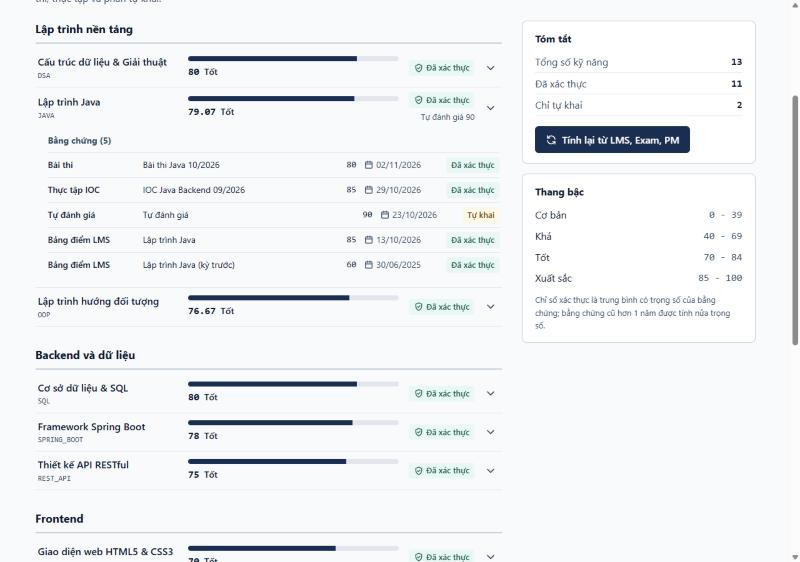
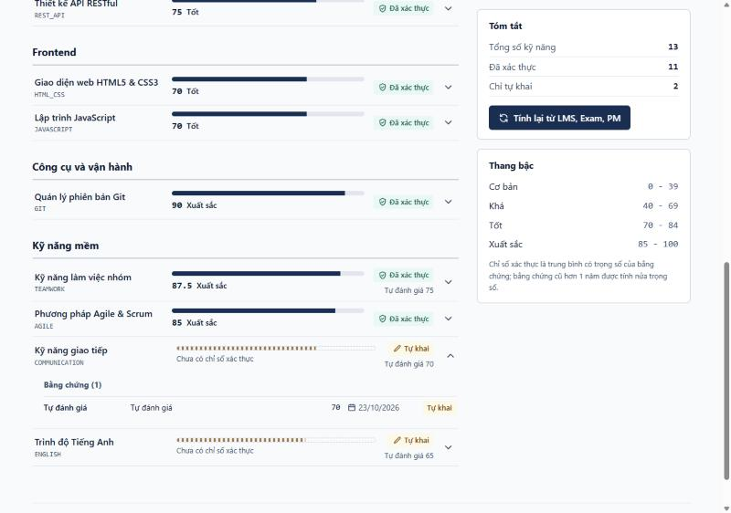

# HS-01 Skill Profile: PR notes

Pull request title: `[HS-01] Skill Profile: skills, evidences and verified scores`

## 1. What this delivers

Each candidate has a list of skills with a 0-100 score and evidences. Verified skills (derived from
LMS, Exam and PM records) are separated from self-declared skills.

- DB: `V3__skill_profile.sql` (schema, production) and `V4__dev_skill_profile_seed.sql` (dev seed).
- BE: `recomputeSkills(userId)`, three endpoints under `/api/v1/profiles`, HTTP Basic sign-in.
- FE: Skill Profile screen (`frontend/src/features/candidate`), reachable from the "Hồ sơ năng lực" tab.

## 2. How to run

```bash
docker compose up -d postgres
cd backend && SPRING_PROFILES_ACTIVE=dev ./mvnw spring-boot:run
cd frontend && npm ci && npm run dev
```

Open `http://127.0.0.1:3000`, choose the "Hồ sơ năng lực" tab and sign in with a seeded account
(`candidate1@rikkeijobs.test`; the dev password is in `V2__dev_seed.sql`).
Swagger UI (dev only): `http://127.0.0.1:8080/swagger-ui.html`.

Tests:

```bash
cd backend && ./mvnw verify spotbugs:check
cd frontend && npm run lint && npm run typecheck && npm test && npm run build
```

## 3. Data model

| Table | Module | Notes |
|---|---|---|
| `skills` | assessment | Adds `skill_group` (PROGRAMMING, BACKEND, FRONTEND, DEVOPS, QUALITY, SOFT_SKILL) |
| `candidate_profiles` | candidate | `is_public`, default `FALSE` |
| `external_records` | candidate | Normalized 0-100 results from LMS, EXAM, PM (stand-in until NT-05) |
| `skill_mappings` | candidate | `(source, source_code) -> skill_id, weight`; the only place the mapping lives |
| `skill_evidences` | candidate | Adds `weight` (copied from the mapping, 1 for non-mapped evidence) |
| `skill_scores` | candidate | `verified_score` is NULL for self-declared-only skills; `level` NULL as well |

No cross-module foreign keys: `user_id` and `skill_id` are plain scalars. The candidate module reads
the catalogue only through `assessment.service.SkillCatalogService`.

## 4. Formula and hand calculation

```text
verified_score = sum(score * weight * timeFactor) / sum(weight * timeFactor)
timeFactor     = 1 if the evidence is within the last year, 0.5 if older
level          = 0-39 Basic, 40-69 Intermediate, 70-84 Advanced, 85-100 Expert
```

candidate1, skill JAVA (seed values; weights come from `skill_mappings`):

| Evidence | Score | Weight | Time factor | score x weight x factor | weight x factor |
|---|---|---|---|---|---|
| LMS JAVA01 | 85 | 0.7 | 1 | 59.5 | 0.70 |
| LMS JAVA01 (previous term, 500 days old) | 60 | 0.7 | 0.5 | 21.0 | 0.35 |
| EXAM EX-JAVA-2026-10 | 80 | 0.8 | 1 | 64.0 | 0.80 |
| PM IOC-JB-2026-09 | 85 | 0.3 | 1 | 25.5 | 0.30 |
| Sum | | | | 170.0 | 2.15 |

`170 / 2.15 = 79.07` (level Advanced).

Adding one more LMS JAVA01 result of 100 (1 day old): numerator `170 + 100 x 0.7 = 240`, denominator
`2.15 + 0.7 = 2.85`, so the score becomes `240 / 2.85 = 84.21`. Both numbers are asserted in
`SkillProfileIntegrationTest.recomputeChangesScore` and `SkillScoreCalculatorTest`.

Try it: `POST /api/v1/profiles/me/skills/recompute` (or the "Tính lại từ LMS, Exam, PM" button).

## 5. API (OpenAPI generated by springdoc, tag "Skill Profile")

| Endpoint | Result |
|---|---|
| `GET /api/v1/profiles/me/skills` | `[{skill, verifiedScore, selfScore, level, evidences:[{source, title, score, recordedAt, verified}]}]` |
| `GET /api/v1/profiles/{userId}/skills` | Same shape; owner always, others only when the profile is public, otherwise 404 `NOT_FOUND` |
| `POST /api/v1/profiles/me/skills/recompute` | Recomputes from `external_records` through `skill_mappings`, returns the new list |

The list is bounded by the 20-skill catalogue, so it is intentionally not paginated.

### 5.1 Acceptance criteria checklist

| Criterion | Evidence |
|---|---|
| candidate1 sees at least 5 skills, each with source and date | 13 skills in the seed; `candidateSeesSkillsWithEvidences` |
| Adding a result and recomputing changes the score per the formula | Section 4; `recomputeChangesScore` |
| Self-declared-only skill shows "Tự khai", no verified score | COMMUNICATION and ENGLISH; `selfOnlySkill`; screenshot below |
| Course-to-skill mapping lives in a table | `mappingLivesInTable` inserts a mapping row and a new skill appears |
| Others calling candidate1 skills while the profile is private get 404 | `privateProfileIsNotFoundForOthers` |
| OpenAPI updated | `/api-docs` lists the three new paths |

## 6. Screenshots





## 7. Decisions and deviations to confirm with the team

- Authentication: the repository had no login yet, so the endpoints use HTTP Basic against the
  `users` table (`DatabaseUserDetailsService`). The principal type (`AuthenticatedUser`) is what the
  SSO ticket login of NT-01 should reuse. Credentials stay in memory in the frontend.
- `skills.name` in the ticket maps to the existing `name_vi` column; `group` is stored as
  `skill_group` because `group` is a reserved word.
- `skill_evidences.weight` is an addition to the ticket schema: the formula needs a per-evidence
  weight and the mapping row may change later.
- Mapping `JAVA01 -> JAVA 0.7, OOP 0.3` (the ticket example mentions SQL 0.3) in the dev seed.
- A candidate with no `candidate_profiles` row is treated as private.
- `self_score` is the score of the most recent SELF evidence.
- Existing migration-count tests were updated because production now applies V1 and V3, and the dev
  profile applies V1 to V4.
- DG-03 will replace the formula with a source-weighted one; it lives in `SkillScoreCalculator`.
